# Architecture

Technical reference for the extension, the native host, and the protocol between them.
For what the project does and how to install it, see `README.md`.

---

## 1. System overview

Two independently built and deployed components, connected only by Firefox native
messaging over stdio.

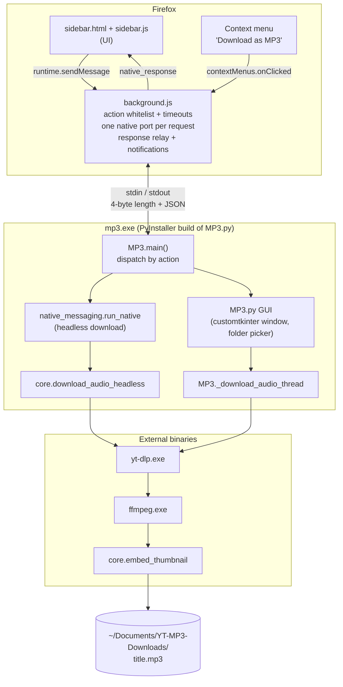

| Component | Source | Language | Artifact | Distribution |
|-----------|--------|----------|----------|--------------|
| Extension | `extension/` | JavaScript, Manifest V2, plain scripts (no bundler, no modules) | Zip of `extension/` | AMO |
| Native host | `host/src/ytmp3_host/` | Python ≥ 3.14 | `mp3.exe` (PyInstaller `--onefile`) | Inno Setup installer |

The extension is a UI and message router only. All file system access, process
execution and dialogs live in the host, because WebExtensions cannot do either.

### Where to look

| Task | Start in |
|------|----------|
| Sidebar UI or behaviour | `extension/sidebar.js`, `extension/sidebar.html` |
| Request routing, timeouts, notifications, context menu | `extension/background.js` |
| Add or change a host action | `MP3.main()` + `ACTION_TIMEOUTS_MS` in `background.js` (see §10) |
| Headless download logic | `native_messaging.run_native`, `core.download_audio_headless` |
| yt-dlp arguments | `core.download_audio_headless` **and** `MP3._download_audio_thread` |
| Filename cleanup, cover art | `core.safe_filename`, `core.embed_thumbnail` |
| Binary/icon paths, default folder | `host/src/ytmp3_host/config.py` |
| Installer, host registration | `packaging/installer/mp3_installer.iss` |

---

## 2. Repository layout

```
extension/                  Firefox add-on; zipped as-is for AMO
  manifest.json             MV2 manifest: permissions, background scripts, sidebar, extension ID
  background.js             Message router, native-messaging client, context menu, notifications
  sidebar.html              Sidebar markup and inline CSS
  sidebar.js                Sidebar logic: fields, buttons, request/response tracking
  youtube.js                isYouTubeUrl(), shared by background and sidebar
  icons/                    48/96 px PNGs

host/
  src/ytmp3_host/
    MP3.py                  Entry point (request loop + dispatch) and the customtkinter GUI
    native_messaging.py     stdio framing, run_native() (headless download handler)
    core.py                 Download, filename sanitizing, thumbnail embedding
    config.py               Paths to ffmpeg.exe, yt-dlp.exe, mp3.ico; DEFAULT_FOLDER
  tests/smoke_native.py     Manual script: spawns the host and sends one message
  bin/                      (gitignored) ffmpeg.exe, yt-dlp.exe for running from source

packaging/
  installer/mp3_installer.iss   Inno Setup script
  app_manifest.dev.json         Native-messaging manifest template for dev machines
  assets/                       mp3.ico

tests/extension/            Node test-runner tests; outside extension/ so they are not shipped
legacy/                     Superseded code, reference only. Not packaged or imported.
pyproject.toml, uv.lock     Python dependencies (pyinstaller in the dev group)
```

---

## 3. Native messaging

### 3.1 Host discovery

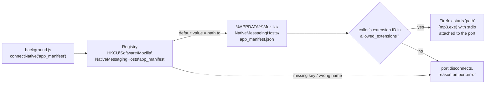

Host manifest, written by the installer:

```json
{
  "name": "app_manifest",
  "description": "YouTube MP3 Converter and Downloader",
  "path": "C:\\Users\\...\\AppData\\Local\\YouTube MP3 Downloader\\mp3.exe",
  "type": "stdio",
  "allowed_extensions": ["yt.downloader@converter.org"]
}
```

Any lookup failure (missing key, wrong name or path, ID not allowed) disconnects the port
immediately with the reason on `port.error`. `background.js` converts this into an error
response; it is what the user sees when the host is not installed.

**Identifiers that must match everywhere.** Changing any of them breaks existing installs
and AMO updates.

| Identifier | Value | Defined in |
|------------|-------|------------|
| Native host name | `app_manifest` | `background.js` (`NATIVE_HOST_NAME`), `mp3_installer.iss` (`NativeHostName`), `app_manifest.dev.json` (`name`), registry subkey, manifest filename |
| Extension ID | `yt.downloader@converter.org` | `extension/manifest.json` (`gecko.id`), `mp3_installer.iss` (`ExtensionID`), `app_manifest.dev.json` (`allowed_extensions`) |
| Executable name | `mp3.exe` | PyInstaller `--name mp3`, `mp3_installer.iss` (`NativeExeName`) |

### 3.2 Wire format

Both directions:

```
[ 4 bytes: length N, unsigned int, native byte order ][ N bytes: UTF-8 JSON ]
```

Implemented in `native_messaging.py`:

- `read_message()`: reads the length via `struct.unpack('@I', ...)`, then N bytes, then
  `json.loads`. On EOF (stdin closed) it calls `sys.exit(0)`; this is the normal shutdown
  path.
- `send_message(dict)`: writes length + JSON to `sys.stdout.buffer` and flushes. On write
  failure (pipe closed) it logs and exits.

stdout is the protocol channel. Any other output to stdout corrupts the stream: no
`print()` in host code. Use `logging` (`mp3.log`, ERROR level).

### 3.3 Process lifetime

`connectNative()` spawns a new process per call, and the extension opens one port per
request, so every request runs in a fresh `mp3.exe`.

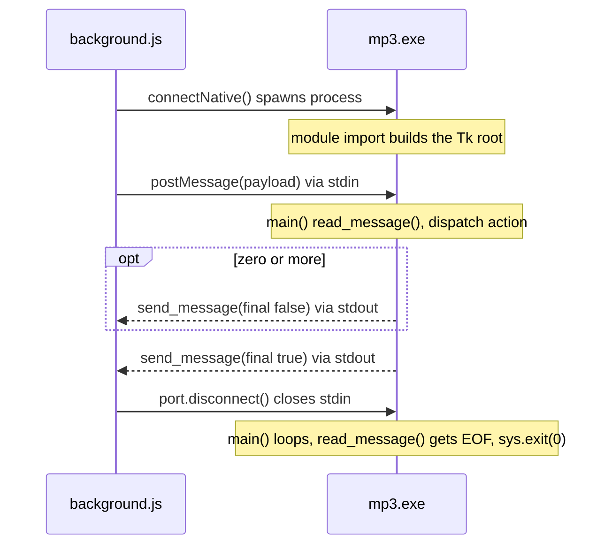

Exception: `download_gui`. Firefox kills the host when its port disconnects, and the Tk
window must outlive the request, so `background.js` leaves that port open
(`KEEP_ALIVE_ACTIONS`). The host sends its final `"GUI opened"` response, then runs
`root.mainloop()` until the window is closed.

---

## 4. Message protocol

### 4.1 Requests (extension → host)

```json
{ "action": "download", "url": "https://...", "folder": "C:\\...", "filename": "..." }
```

| `action` | Fields | Host behaviour | Timeout (`background.js`) |
|----------|--------|----------------|---------------------------|
| `download` | `url`, `folder?`, `filename?` | Headless download, `run_native()` | 6 min |
| `download_gui` | `url?`, `folder?`, `filename?` | Opens the pre-filled Tk window, `run_native_gui()` | 30 s (until `"GUI opened"`) |
| `select_folder` | — | Folder picker, returns the selected folder | 10 min (user interaction) |
| `get_current_folder` | — | Returns the host's current/default folder | 15 s |

The host treats a missing or unknown `action` as `download`. `background.js` rejects
unknown actions before spawning the host, so this path is not reached from the extension.

### 4.2 Responses (host → extension)

```json
{ "status": "success" | "error" | "warning",
  "message": "...", "filename": "...", "path": "...", "folder": "...",
  "final": true | false }
```

| Field | Meaning |
|-------|---------|
| `final: false` | Intermediate message; request still running. Currently only warnings ("Invalid folder path, using default", "Could not fetch title, using default"). |
| `final: true` | Last message for the request. Exactly one per request. |
| `filename`, `path` | Set on a successful download. |
| `folder` | Set by folder actions. |

If `final` is absent, `background.js` treats `success`/`error` as final and anything else
as intermediate.

### 4.3 Extension envelope

`background.js` relays every response to extension pages as:

```json
{ "type": "native_response", "requestId": "<uuid>", "final": true, "...": "host fields" }
```

`requestId` correlates a response with the sidebar call that issued it.

---

## 5. Extension

All files are plain scripts sharing one global scope per page. `youtube.js` is loaded
before the page script in both the background page and the sidebar, which makes
`isYouTubeUrl` a global in both.

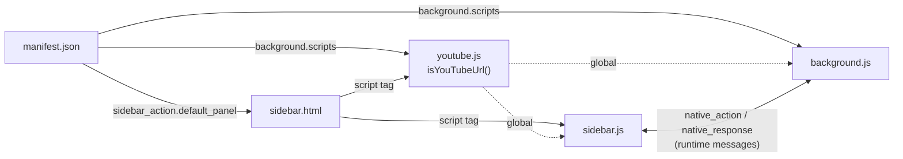

### 5.1 `background.js`

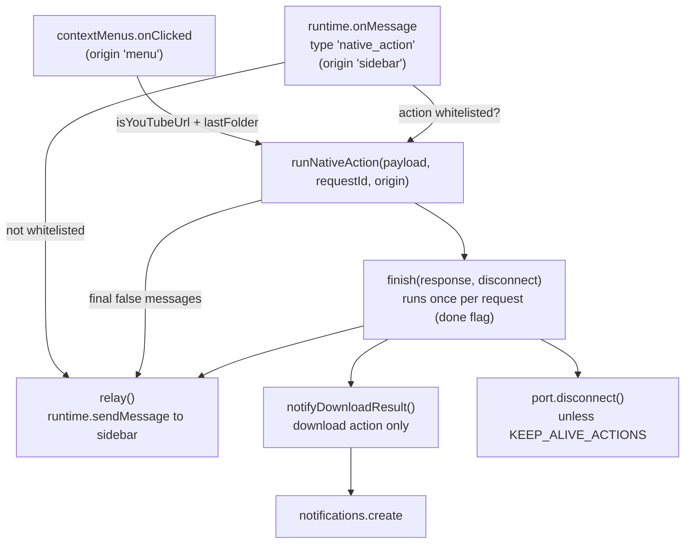

| Function / listener | Responsibility |
|---------------------|----------------|
| `contextMenus.create` (top level) | Registers "Download as MP3" for YouTube watch/shorts/youtu.be links. Runs on every startup because MV2 persistent backgrounds do not keep menus across restarts. |
| `runtime.onMessage` | Accepts `native_action` from the sidebar. Rejects actions not in `ACTION_TIMEOUTS_MS`. Copies only `action`, `url`, `folder`, `filename` into the payload. |
| `contextMenus.onClicked` | Validates the link, adds `storage.local.lastFolder` if set, starts a `download`. |
| `runNativeAction(payload, requestId, origin)` | Opens the port, posts the payload, starts the timeout. Guarantees exactly one final response via `finish()`. |
| `relay(message)` | Sends `native_response` to extension pages. Rejection (no page open) is ignored. |
| `notifyDownloadResult(origin, response)` | `download` only. Context-menu downloads always notify; sidebar downloads notify only if the sidebar is closed when the result arrives. |

`runNativeAction` completion: the first trigger wins, later ones are ignored.

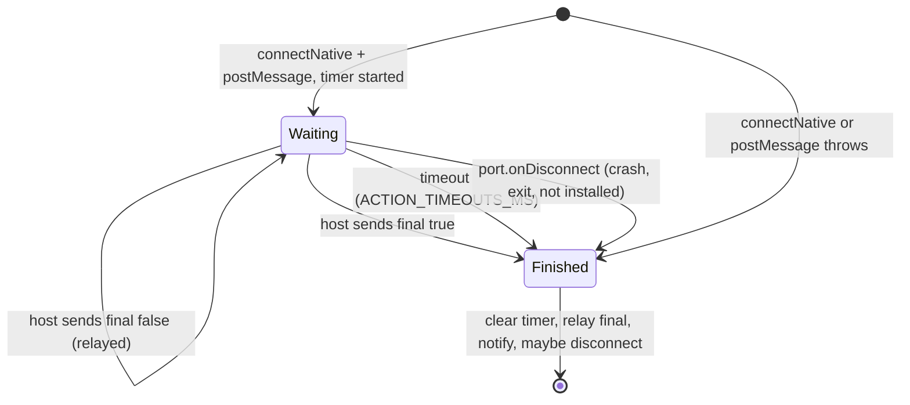

### 5.2 `sidebar.js`

| Area | Behaviour |
|------|-----------|
| Request tracking | `sendNativeAction(message, onResponse)` generates a `requestId` and stores the callback in `pendingRequests`. The `runtime.onMessage` listener dispatches each response by `requestId` and removes the entry on `final`. |
| URL field | `syncUrlFromActiveTab()` mirrors the active tab's URL when it is a YouTube video, on tab switch and in-page navigation. Skipped once the user types a URL (`autofilledUrl` tracks the last autofilled value). |
| Folder field | `loadFolder()` uses `storage.local.lastFolder`; if unset, requests `get_current_folder` and stores the result. "Choose" sends `select_folder`. Manual edits are saved on `change`; an empty value removes the key. Context-menu downloads use the same key. |
| Download button | Validates with `isYouTubeUrl`, sends `download`. Intermediate responses show as info/warning, the final one as success/error. |
| Open in app button | Sends `download_gui` with whichever fields are filled. |
| `showResult()` / `clearResult()` | Status pill; success messages auto-hide after 5 s. |

### 5.3 `youtube.js`

`isYouTubeUrl(value)` accepts http(s) URLs on `youtube.com`, `www.`, `m.`, `music.` or
`youtu.be`, with path `/watch?v=…`, `/shorts/…`, or a non-empty `youtu.be/<id>`.

The host validates much more loosely (substring `youtube.com` / `youtu.be/` in
`run_native`; only `youtube.com` in the GUI). The extension check is the effective
validation.

---

## 6. Native host

### 6.1 Module dependencies

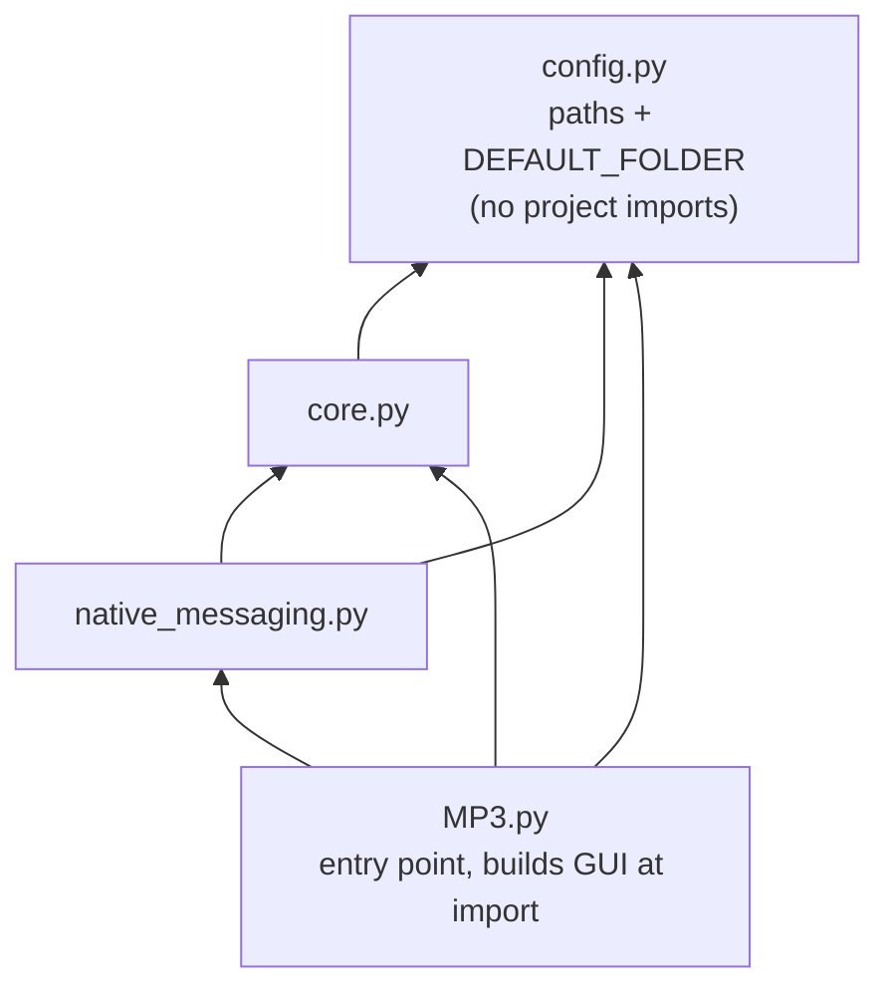

Arrows point from importer to imported. `MP3.py` is the only entry point; `__init__.py`
is empty.

### 6.2 `config.py`

| Mode | Detection | `ffmpeg.exe`, `yt-dlp.exe` | `mp3.ico` |
|------|-----------|----------------------------|-----------|
| Installed | `sys.frozen` (PyInstaller) | Directory of `sys.executable` | Directory of `sys.executable` |
| Source checkout | otherwise | `host/bin/` (placed manually) | `packaging/assets/` |

`DEFAULT_FOLDER = ~/Documents/YT-MP3-Downloads`.

### 6.3 `MP3.py`

**Module-level GUI construction.** `root = ctk.CTk()`, the `url_var` / `folder_var` /
`filename_var` StringVars and all widgets are created at import. Consequences:

- Every host process creates a Tk root, including headless downloads.
- Importing `ytmp3_host.MP3` anywhere creates a window.
- `folder_var` starts as `DEFAULT_FOLDER` in every process.

**`main()` request loop.**

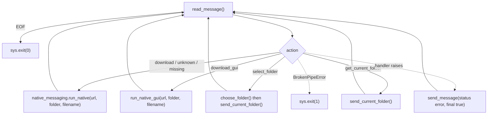

**GUI functions.**

| Function | Behaviour |
|----------|-----------|
| `run_native_gui(url, folder, filename)` | Pre-fills the StringVars. Invalid folder → error response, window not opened. Otherwise schedules the final `"GUI opened"` response (100 ms) and blocks in `root.mainloop()`. |
| `choose_folder()` | `filedialog.askdirectory`; sets `folder_var` on selection. |
| `send_current_folder()` | Responds with `folder_var`. Empty → creates and returns the default folder. Non-existent path → error. |
| `download_audio()` | Starts `_download_audio_thread()` on a daemon thread to keep the UI responsive. |
| `_download_audio_thread()` | GUI download path (§7.2). Updates widgets only via `root.after(0, …)`, since Tk is not thread-safe. Parses yt-dlp `NN.N%` output for the progress bar. |
| `cancel_download()` | Sets `root.download_cancelled`, kills yt-dlp if still running, resets the UI, starts `cleanup_partial_downloads()` on a thread. |
| `cleanup_partial_downloads(folder, filename)` | Waits 10 s for file locks to release, then deletes `.part`, `.ytdl`, `.jpg`, `.webp`, `_temp*.mp3`, `.mp3` for that name, retrying locked files. |
| `reset_fields()` | Clears the form and restores the "Download MP3" button. |

Main button states:

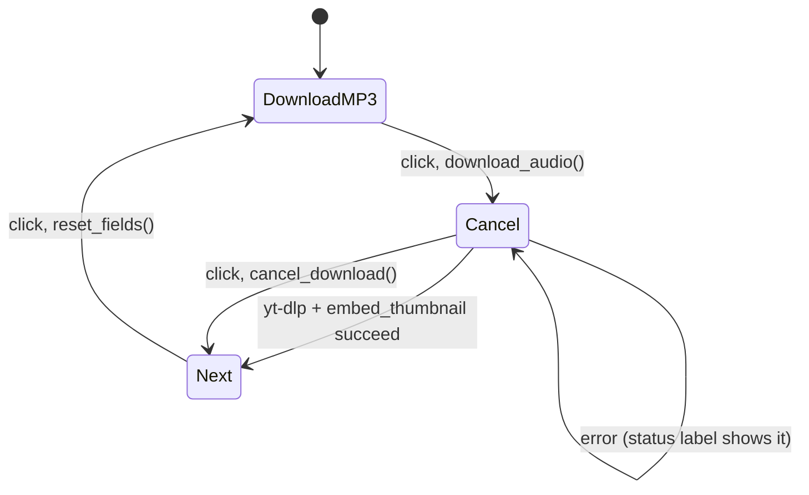

### 6.4 `native_messaging.py`

`read_message()` / `send_message()`: see §3.2.

`run_native(url, folder, i_filename)` handles a headless `download`:

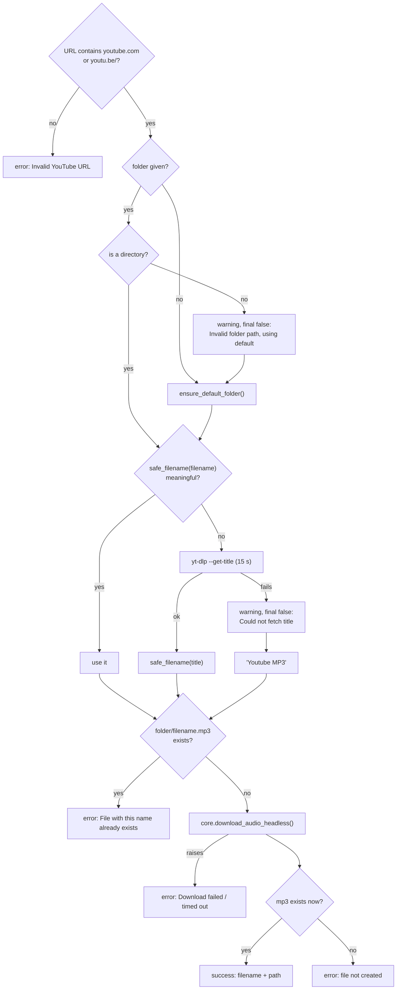

### 6.5 `core.py`

| Function | Behaviour |
|----------|-----------|
| `safe_filename(name)` | Strips `\/*?:"<>|`; removes whole-word noise (`Official`, `Music`, `Video`, `HD`, `Lyrics`, `Lyric`, `Audio`, `Explicit`); removes resulting empty `()`/`[]`; collapses whitespace. Empty → `"Youtube MP3"`. |
| `ensure_default_folder()` | Creates `DEFAULT_FOLDER` if missing; returns it. |
| `download_audio_headless(url, folder, filename)` | Artist = text before the first `-` in the filename, else `<unknown>`. Runs yt-dlp (300 s timeout), then `embed_thumbnail`. If the target exists or ffmpeg is missing it only logs and returns; `run_native`'s post-download existence check reports the failure. |
| `embed_thumbnail(mp3_file, thumb_file, artist)` | Center-crops the `.jpg` to 1:1 (Pillow). ffmpeg stream-copies audio + image into `<name>_temp<pid>.mp3` as ID3v2.3 with cover art and `artist`. Replaces the original mp3 and deletes the jpg. On error removes the temp file and re-raises. Writing to a temp file avoids corrupting the mp3 if ffmpeg fails. |

### 6.6 yt-dlp invocation

Duplicated in `core.download_audio_headless` and `MP3._download_audio_thread`; keep both
in sync.

```
yt-dlp.exe --no-playlist --concurrent-fragments 3
           -x --audio-format mp3
           --write-thumbnail --convert-thumbnails jpg
           --ffmpeg-location <ffmpeg.exe>
           --newline
           -o "<folder>/<filename>.%(ext)s"
           <url>
```

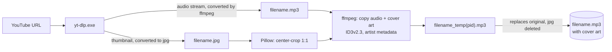

`--newline` emits one progress line per update, which the GUI parses.

---

## 7. Request flows

### 7.1 Sidebar download (headless)

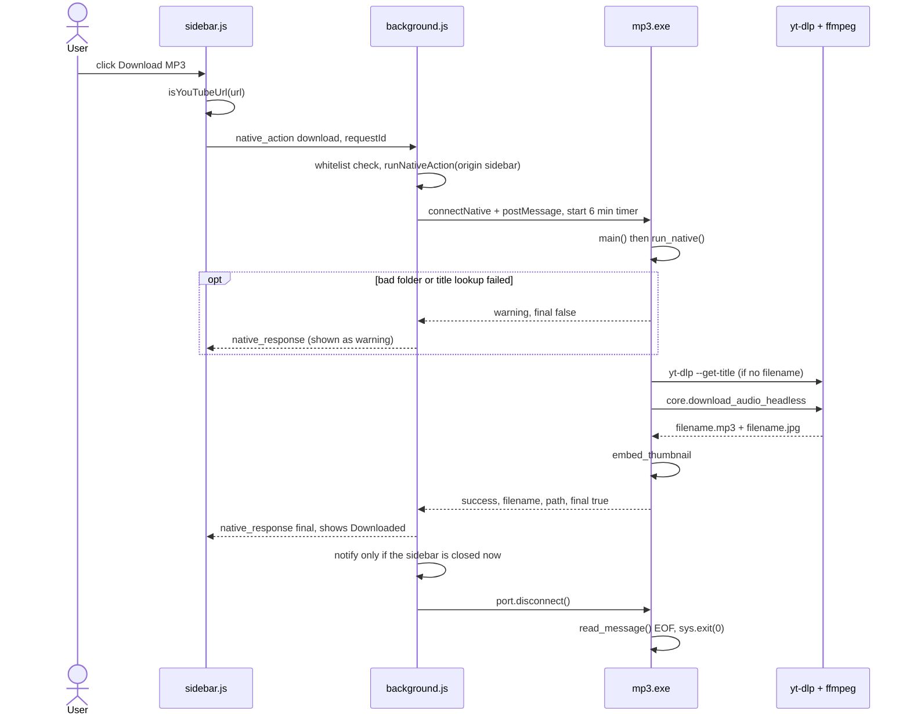

### 7.2 Open in app (GUI)

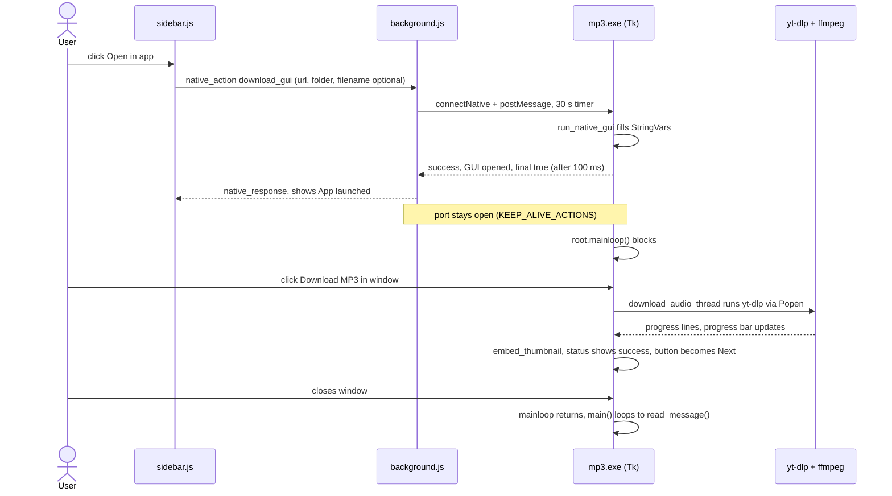

After `"GUI opened"`, the GUI reports nothing back to the extension.

### 7.3 Context-menu download

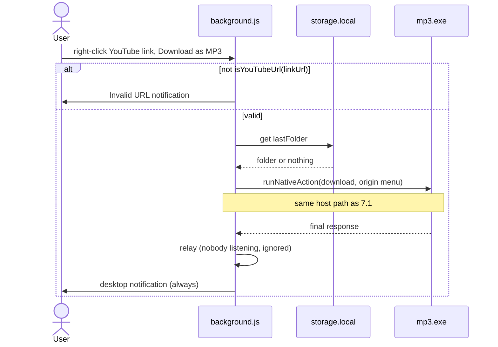

### 7.4 Folder actions

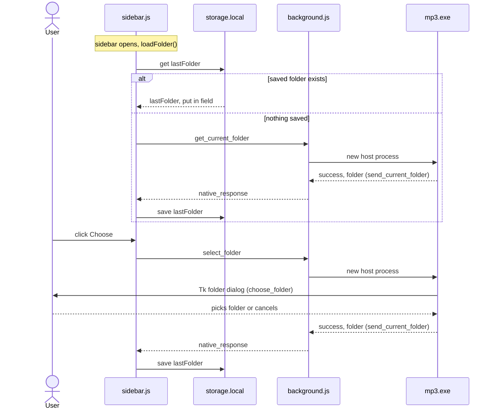

Each process starts with `folder_var = DEFAULT_FOLDER`, so cancelling the dialog returns
the default folder, not the previously selected one.

---

## 8. Build and release

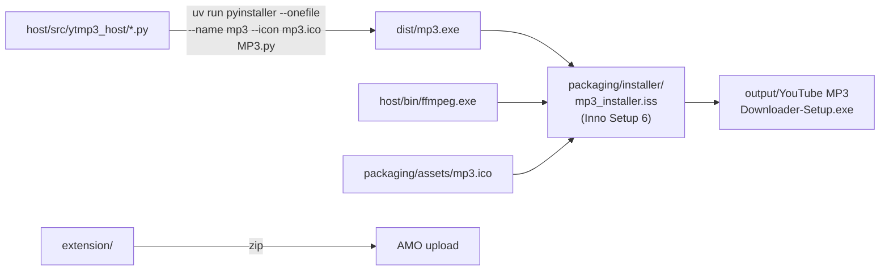

Installer steps (per-user, no elevation):

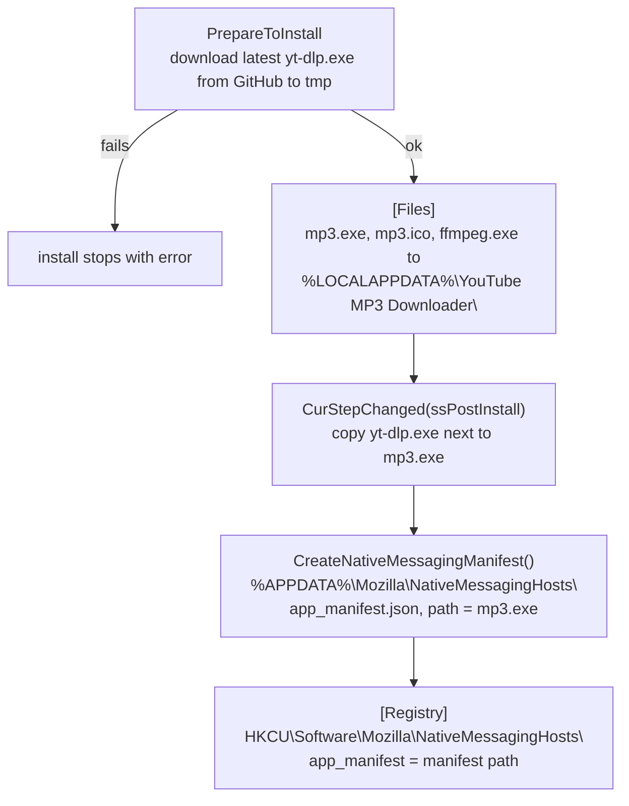

- yt-dlp is downloaded at install time, not bundled: YouTube changes regularly break older
  yt-dlp versions. A failed download aborts the install.
- All binaries and the icon land in one folder, matching `config.py`'s frozen-mode paths.
- Uninstall removes the registry key, the host manifest, `yt-dlp.exe` and `mp3.log`
  (listed under `[UninstallDelete]` because they are created at runtime, not via `[Files]`).
- The extension is versioned and released separately (`manifest.json` `version` vs.
  `MyAppVersion` in the `.iss`).

---

## 9. Development workflow

| Task | How |
|------|-----|
| Python environment | `uv sync`; place `ffmpeg.exe` and `yt-dlp.exe` in `host/bin/`. |
| Register a dev host | Copy `packaging/app_manifest.dev.json` to `%APPDATA%\Mozilla\NativeMessagingHosts\app_manifest.json`, set `path` to your `dist\mp3.exe`, remove the `"\\"` comment key, and create the `HKCU` key from §3.1 (or run the installer once). |
| Test host changes through Firefox | Rebuild `mp3.exe` with PyInstaller; the manifest points at an executable. |
| Test the host without Firefox | `uv run python host/tests/smoke_native.py`. Sends one hard-coded message to `dist/mp3.exe` (fallback: `python -m ytmp3_host.MP3`) and prints the reply. Edit `message` to change the action. Not pytest-safe: calls yt-dlp at import. |
| Load the extension | `about:debugging` → Load Temporary Add-on → `extension/manifest.json`. |
| Extension tests | `node --test tests/extension/` |

Extension test harness:

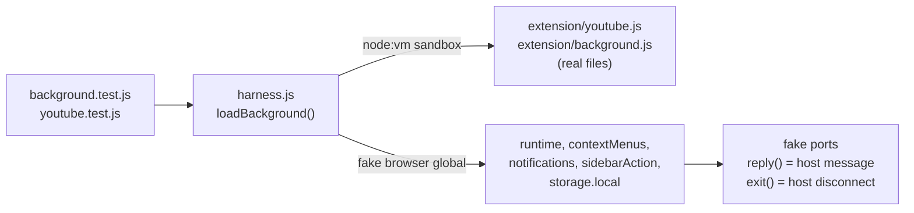

`background.test.js` covers the request lifecycle: single final response, keep-alive,
timeouts, disconnect errors, notifications, context menu. `youtube.test.js` covers
`isYouTubeUrl`. `sidebar.js` and the Python host have no automated tests.

---

## 10. Invariants and change checklist

**Invariants**

- No stdout output in host code other than `send_message`.
- Exactly one `final: true` response per request. Intermediate responses must set
  `final: false` explicitly.
- `ACTION_TIMEOUTS_MS.download` (6 min) must exceed host title lookup (15 s) + yt-dlp
  timeout (300 s); otherwise the extension times out while the host is still working.
- `app_manifest`, `yt.downloader@converter.org` and `mp3.exe` are fixed (§3.1).
- Reusable host logic belongs in `core.py` / `native_messaging.py`, not `MP3.py`
  (importing `MP3.py` creates a window).

**Adding a host action**

1. `ACTION_TIMEOUTS_MS` in `background.js` (whitelist + timeout).
2. `actions` dict in `MP3.main()`.
3. Caller in `sidebar.js`.
4. `KEEP_ALIVE_ACTIONS` if the host must outlive its final response.
5. A test in `tests/extension/background.test.js` if lifecycle behaviour changes.

**Changing yt-dlp arguments:** update both `core.download_audio_headless` and
`MP3._download_audio_thread`.

**Logging:** `mp3.log` in the process working directory (the installer assumes the
install folder), ERROR level.

---

## 11. Known issues

| Issue | Location | Effect |
|-------|----------|--------|
| `get_current_folder` does not create the default folder | `send_current_folder()` | `folder_var` is pre-set to `DEFAULT_FOLDER`, so the "empty → create" branch never runs. If the folder does not exist, the response is `"Path doesn't exist"`. |
| Host lingers after a rejected `download_gui` | `run_native_gui()` + `KEEP_ALIVE_ACTIONS` | Invalid folder → error, no window, but the port stays open. The process waits on stdin until the extension reloads or Firefox exits. |
| Dead auto-close code | `_download_audio_thread()` | Checks `root.close_var`, which is never set. |
| Redundant checks in headless download | `download_audio_headless()` | "File exists" and "ffmpeg missing" are only logged; the user sees the generic "Download failed, file not created" from `run_native`. |
