# Architecture

Technical reference for the extension, the native host, the protocol between them, and
how the host keeps itself working (updates and repairs). For what the project does and
how to install it, see `README.md`.

---

## 1. System overview

Two independently built and deployed components, connected only by Firefox native
messaging over stdio. The host also talks to GitHub: to look up releases and download
updates of itself, yt-dlp and (when needed) Deno.

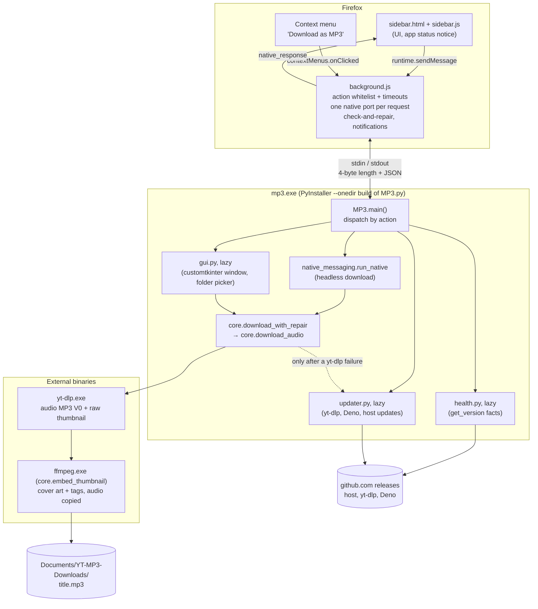

| Component   | Source                 | Language                                                        | Artifact                                                   | Distribution                    |
|-------------|------------------------|-----------------------------------------------------------------|------------------------------------------------------------|---------------------------------|
| Extension   | `extension/`           | JavaScript, Manifest V2, plain scripts (no bundler, no modules) | Zip of `extension/`                                        | AMO (Firefox updates it)        |
| Native host | `host/src/ytmp3_host/` | Python ≥ 3.15                                                   | `dist/mp3/mp3.exe` + `_internal/` (PyInstaller `--onedir`) | Inno Setup installer on GitHub  |

The extension is a UI and message router; it also decides what to repair and what to
tell the user. All file system access, process execution, network downloads and dialogs
live in the host, because WebExtensions cannot do them.

### Where to look

| Task                                                   | Start in                                                                            |
|--------------------------------------------------------|-------------------------------------------------------------------------------------|
| Sidebar UI or behaviour                                | `extension/sidebar.js`, `extension/sidebar.html`                                    |
| Request routing, timeouts, notifications, context menu | `extension/background.js`                                                           |
| What the user is told about the app, which repairs run | `background.js`: `checkAndRepairHost`, `neededRepairs`, `assessHostStatus`          |
| Add or change a host action                            | `MP3.ACTIONS` + `ACTION_TIMEOUTS_MS` in `background.js` (see §11)                   |
| Download logic (headless and GUI)                      | `core.download_audio`; request handling in `native_messaging.run_native` / `gui.py` |
| Retry after a yt-dlp failure, Deno on demand           | `core.download_with_repair`                                                         |
| yt-dlp arguments                                       | `core.build_download_command`                                                       |
| Filename cleanup, cover art, tags                      | `core.safe_filename`, `core.embed_thumbnail`, `core.artist_for`, `core.extra_tags`  |
| Updates of yt-dlp, Deno and the host                   | `host/src/ytmp3_host/updater.py`                                                    |
| Versions and tool state reported to the extension      | `host/src/ytmp3_host/health.py`                                                     |
| What a new version must pass before it is switched to  | `host/src/ytmp3_host/selfcheck.py`                                                  |
| GUI window, folder picker                              | `host/src/ytmp3_host/gui.py`                                                        |
| Paths, install layout, logging                         | `host/src/ytmp3_host/config.py`                                                     |
| Installer, host registration                           | `packaging/installer/mp3_installer.iss`                                             |

---

## 2. Repository layout

```
extension/                  Firefox add-on; zipped as-is for AMO
  manifest.json             MV2 manifest: permissions, background scripts, sidebar, extension ID
  background.js             Message router, native-messaging client, check-and-repair, context menu, notifications
  sidebar.html              Sidebar markup and inline CSS
  sidebar.js                Sidebar logic: fields, buttons, app status notice, request/response tracking
  youtube.js                URL checks (isYouTubeUrl, isKnownSiteUrl, isWebUrl), shared by background and sidebar
  icons/                    48/96 px PNGs

host/
  src/ytmp3_host/
    __init__.py             __version__ (the host version)
    MP3.py                  Entry point: ACTIONS dispatch table, the request loop, --self-check
    native_messaging.py     stdio framing, run_native() (headless download), run_open_file(), send_current_folder()
    core.py                 Download pipeline and repair, filename sanitizing, folders, tags, cover art, file opening
    config.py               Install layout and paths, DEFAULT_FOLDER, setup_logging()
    health.py               get_version facts: versions, tool state; version parsing and comparison
    github.py               latest_release_tag() (one HEAD request per lookup)
    updater.py              update_yt_dlp(), install_deno(), update_host(), launch_detached(), the update lock
    selfcheck.py            mp3.exe --self-check, run by the installer
    gui.py                  customtkinter window and folder picker (imported only by GUI actions)
  tests/smoke_native.py     Manual script: spawns the host and sends one message
  bin/                      (gitignored) ffmpeg.exe, yt-dlp.exe for running from source

packaging/
  installer/mp3_installer.iss   Inno Setup script
  write_checksums.py            Writes SHA256SUMS for a release
  app_manifest.dev.json         Native-messaging manifest template for dev machines
  assets/                       mp3.ico

tests/extension/            Node test-runner tests; outside extension/ so they are not shipped
tests/host/                 pytest tests of the native host, fake_yt_dlp.py (§10.2)
legacy/                     Superseded code, reference only. Not packaged or imported.
pyproject.toml, uv.lock     Python dependencies (pyinstaller, pytest, pyrefly in the dev group)
PLAN.md                     Roadmap
```

---

## 3. Native messaging

### 3.1 Host discovery

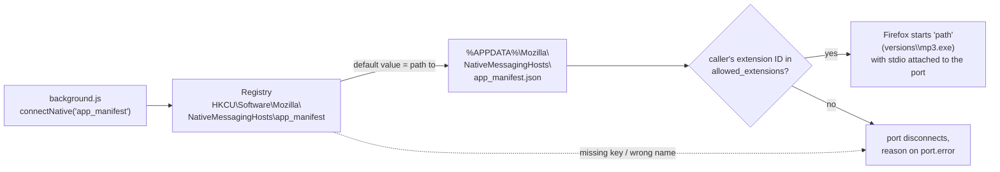

Host manifest, written by the installer. `path` points at one version folder; switching
Firefox to a new version means rewriting this file (§7.5).

```json
{
  "name": "app_manifest",
  "description": "YouTube MP3 Converter and Downloader",
  "path": "C:\\Users\\...\\AppData\\Local\\YouTube MP3 Downloader\\versions\\2.0.0\\mp3.exe",
  "type": "stdio",
  "allowed_extensions": ["yt.downloader@converter.org"]
}
```

The installer writes it as pure ASCII (non-ASCII characters of the path as `\uXXXX`):
Inno Setup writes files in the ANSI code page, Firefox reads them as UTF-8.

Any lookup failure (missing key, wrong name or path, ID not allowed) disconnects the port
immediately with the reason on `port.error`. `background.js` turns "No such native
application" into the "not installed" message with the installer link.

**Identifiers that must match everywhere.** Changing any of them breaks existing installs
and AMO updates.

| Identifier       | Value                         | Defined in                                                                                                                                         |
|------------------|-------------------------------|----------------------------------------------------------------------------------------------------------------------------------------------------|
| Native host name | `app_manifest`                | `background.js` (`NATIVE_HOST_NAME`), `mp3_installer.iss` (`NativeHostName`), `app_manifest.dev.json` (`name`), registry subkey, manifest filename |
| Extension ID     | `yt.downloader@converter.org` | `extension/manifest.json` (`gecko.id`), `mp3_installer.iss` (`ExtensionID`), `app_manifest.dev.json` (`allowed_extensions`)                        |
| Executable name  | `mp3.exe`                     | PyInstaller `--name mp3`, `mp3_installer.iss` (`NativeExeName`)                                                                                    |
| Installer AppId  | `YouTube MP3 Downloader`      | `mp3_installer.iss` (`AppName`; no `AppId` is set, so it is the AppId). Changing it makes an update install a second app instead of upgrading.     |
| Installer asset  | `YT-MP3-Downloader-Setup.exe` | `OutputBaseFilename`, `updater.INSTALLER_ASSET`, `INSTALLER_URL` in `background.js` (checked by `test_versions.py`)                                |

### 3.2 Wire format

Both directions:

```
[ 4 bytes: length N, unsigned int, native byte order ][ N bytes: UTF-8 JSON ]
```

Implemented in `native_messaging.py`:

- `read_message()`: reads exactly 4 bytes of length (`struct` `@I`), then exactly N bytes,
  then `json.loads`. On EOF (stdin closed, also mid-message) it calls `sys.exit(0)`; this
  is the normal shutdown path. A message that is not a JSON object raises `ValueError`,
  which `main()` reports as a final error.
- `send_message(dict)`: writes length + JSON to `sys.stdout.buffer` and flushes. On write
  failure (pipe closed) it logs and exits.

stdout is the protocol channel. Any other output to stdout corrupts the stream: no
`print()` in host code; log through `logging` (§6.2). Child processes get
`stdin=DEVNULL`, or they could read bytes meant for the host.

### 3.3 Process lifetime

`connectNative()` spawns a new process per call, and the extension opens one port per
request, so every request runs in a fresh `mp3.exe`.

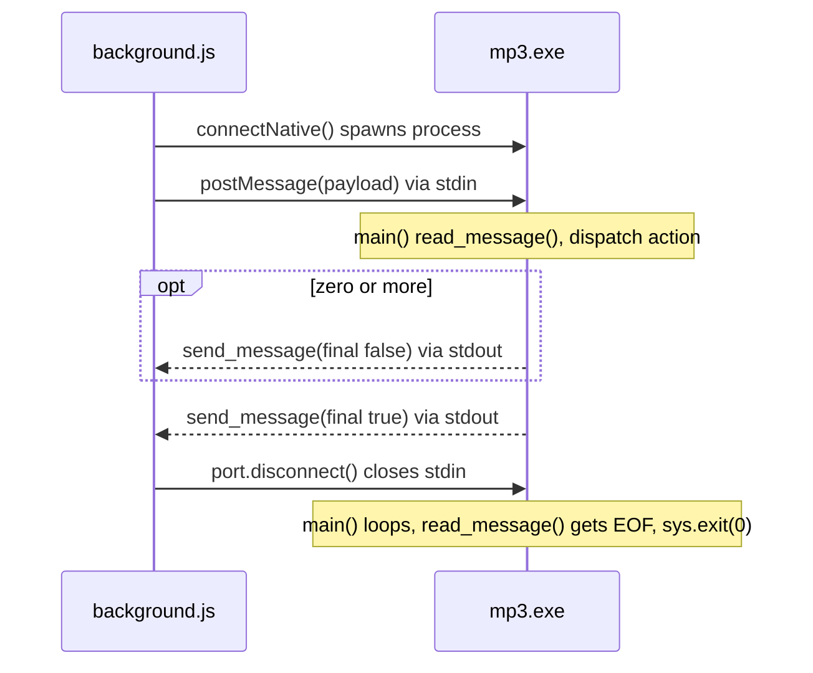

Exceptions:

- `download_gui`: Firefox kills the host when its port disconnects, and the Tk window
  must outlive the request, so `background.js` leaves that port open
  (`KEEP_ALIVE_ACTIONS`). The host sends its final `"GUI opened"` response, runs
  `mainloop()` until the window is closed, and then exits by itself (`sys.exit(0)` in
  `MP3.download_gui`), since nothing will close its stdin.
- Processes that must outlive the host (the installer of a host update, the player of
  `play`) are started with `updater.launch_detached`: `DETACHED_PROCESS` +
  `CREATE_BREAKAWAY_FROM_JOB`, so they leave Firefox's job object, which ends with the
  host. They start in the temp folder, not in the host's working directory (its version
  folder), so the installer can remove that folder.

---

## 4. Message protocol

### 4.1 Requests (extension → host)

```json
{ "action": "download", "url": "https://...", "folder": "C:\\...", "filename": "..." }
```

| `action`             | Fields                         | Host behaviour                                                                                      | Timeout (`background.js`)   |
|----------------------|--------------------------------|-----------------------------------------------------------------------------------------------------|-----------------------------|
| `download`           | `url`, `folder?`, `filename?`  | Headless download, `run_native()` (with one repair and retry, §7.6)                                 | 27 min                      |
| `download_gui`       | `url?`, `folder?`, `filename?` | Opens the pre-filled Tk window, `gui.open_gui()`                                                    | 30 s (until `"GUI opened"`) |
| `select_folder`      | `folder?`                      | Folder picker starting at `folder`; returns the selection, or `folder` (else the default) on cancel | 10 min (user interaction)   |
| `get_current_folder` | —                              | Returns the default folder, creating it if missing                                                  | 15 s                        |
| `show_in_folder`     | `path`                         | Opens the MP3's folder in Explorer with it selected (`core.show_in_folder`)                         | 15 s                        |
| `play`               | `path`                         | Opens the MP3 in its default app, through Explorer (`core.open_file`)                               | 15 s                        |
| `get_version`        | —                              | The host version and the state of its tools (`health.host_status`, §7.1)                            | 30 s                        |
| `update_yt_dlp`      | —                              | Installs the latest yt-dlp, or repairs a missing/broken one (`updater.update_yt_dlp`)               | 7 min                       |
| `update_host`        | —                              | Starts the installer of a newer host release (`updater.update_host`)                                | 9 min                       |
| `ping`               | —                              | Answers with `version` only; sent by the self-check (§7.5), not by the extension                    | —                           |

`show_in_folder` and `play` only accept an absolute path to an existing `.mp3`
(`core.downloaded_mp3`); anything else is "The MP3 was moved or deleted". `play` must
never run a program.

The host treats a missing or unknown `action` as `download`. `background.js` rejects
unknown actions before spawning the host, so this path is not reached from the extension
(1.x hosts behave the same way, which is how the extension recognizes them, §7.1).

### 4.2 Responses (host → extension)

```json
{ "status": "success" | "error" | "warning" | "info",
  "message": "...", "filename": "...", "path": "...", "folder": "...",
  "final": true | false }
```

| Field              | Meaning                                                                                                                                                                                                                                                                                                                                         |
|--------------------|-------------------------------------------------------------------------------------------------------------------------------------------------------------------------------------------------------------------------------------------------------------------------------------------------------------------------------------------------|
| `final: false`     | Intermediate message; request still running. `download` sends warnings ("Could not fetch the video title, …", "No thumbnail found, …") and infos about a repair ("The download failed, checking for a yt-dlp update...", "Trying the download again..."). The final success repeats the warnings in `message`, since the sidebar replaces them. |
| `final: true`      | Last message for the request. Exactly one per request.                                                                                                                                                                                                                                                                                          |
| `filename`, `path` | Set on a successful download.                                                                                                                                                                                                                                                                                                                   |
| `folder`           | Set by folder actions.                                                                                                                                                                                                                                                                                                                          |
| `version`          | `get_version`: the host version. `update_host`: the tag being installed, or `null` if this host is the latest.                                                                                                                                                                                                                                  |
| `yt_dlp`           | `get_version`: see §7.1. `update_yt_dlp`: `{ "version": "<installed version>" }`.                                                                                                                                                                                                                                                               |

If `final` is absent, `background.js` treats `success`/`error` as final and anything else
as intermediate.

`get_version` answer:

```json
{ "status": "success",
  "version": "2.0.0", "latest": "v2.0.0", "outdated": false, "self_update": true,
  "yt_dlp": { "installed": true, "version": "2026.10.21", "latest": "2026.10.21", "outdated": false },
  "ffmpeg": { "installed": true },
  "js_runtime": { "name": "deno", "installed": false },
  "final": true }
```

`null` means unknown (e.g. offline: `latest` and `outdated` are `null`) and never
triggers a repair.

### 4.3 Extension envelope

`background.js` relays every response to extension pages as:

```json
{ "type": "native_response", "requestId": "<uuid>", "final": true, "...": "host fields" }
```

`requestId` correlates a response with the sidebar call that issued it. A response may
also carry `helpUrl` (added by `background.js`): the installer download, which the sidebar
shows as a "Download the installer" link with a hint about the unsigned-installer warnings.

---

## 5. Extension

All files are plain scripts sharing one global scope per page. `youtube.js` is loaded
before the page script in both the background page and the sidebar, which makes its URL
checks globals in both.

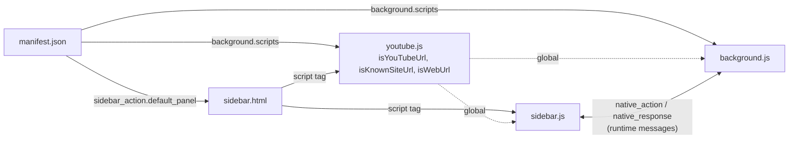

The extension must never ask for a permission 1.x did not have: Firefox holds back an
update with a new required permission until the user approves it. Use
`optional_permissions` instead (`test_versions.py` checks the list).

### 5.1 `background.js`

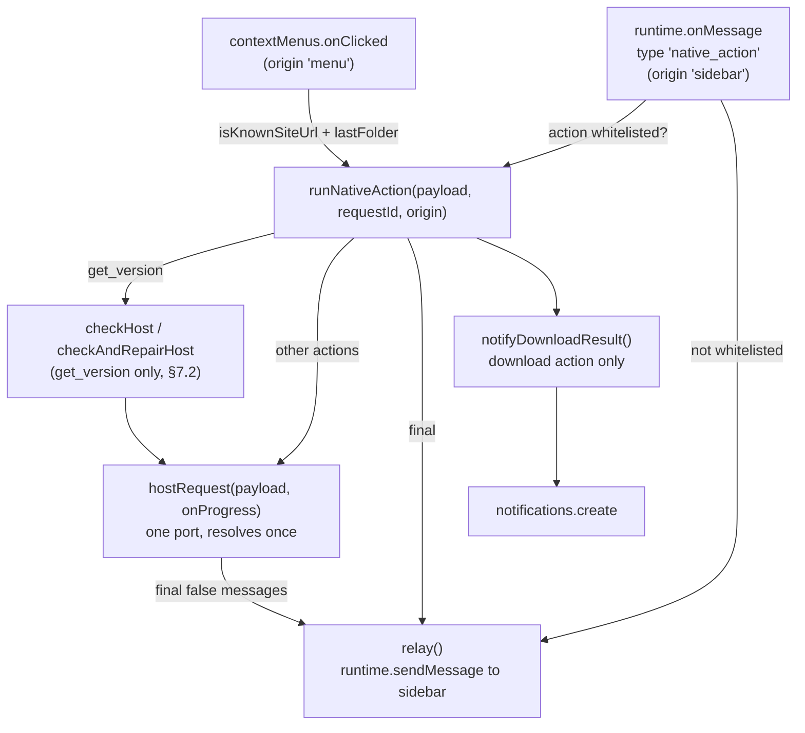

| Function / listener                           | Responsibility                                                                                                                                                                                                                       |
|-----------------------------------------------|--------------------------------------------------------------------------------------------------------------------------------------------------------------------------------------------------------------------------------------|
| `contextMenus.create` (top level)             | Registers "Download as MP3" for YouTube, SoundCloud, Bandcamp and Mixcloud links (`targetUrlPatterns`). Runs on every startup because MV2 persistent backgrounds do not keep menus.                                                  |
| `browserAction.onClicked`                     | The toolbar button (`default_area: navbar`): toggles the sidebar, which Firefox gives no launcher when tabs are on top. `toggle()` is called directly, as it needs the user action. Remembers the click time for `toolbarTipWanted`. |
| `runtime.onMessage` (`toolbar_tip`)           | Answers the sidebar with `toolbarTipWanted()`: true if the button is pinned and the sidebar opened without it (no click in 5 s, not restored at startup), until dismissed. Extensions can't unpin the button themselves.             |
| `runtime.onMessage`                           | Accepts `native_action` from the sidebar. Rejects actions not in `ACTION_TIMEOUTS_MS`. Copies only `action`, `url`, `folder`, `filename`, `path` into the payload.                                                                   |
| `contextMenus.onClicked`                      | Validates the link (`isKnownSiteUrl`), adds `storage.local.lastFolder` if set, starts a `download`, then `checkHostInBackground`.                                                                                                    |
| `checkHostInBackground()`                     | A silent `checkHost` for context-menu-only users, at most once a day: 1 min after startup and after a context-menu download. Any check counts; its start time is `storage.local.lastHostCheck` (§7.2).                               |
| `runNativeAction(payload, requestId, origin)` | Runs the request (`get_version` through `checkHost`), relays intermediate responses, then exactly one final one; notifies for downloads.                                                                                             |
| `hostRequest(payload, onProgress)`            | Opens the port, posts the payload, starts the timeout. Resolves once with `{ response, source }`; `source` is `host`, `timeout`, `disconnect` or `connect`.                                                                          |
| `checkHost(onProgress)`                       | One check-and-repair at a time; a second caller shares the running one (§7.2).                                                                                                                                                       |
| `relay(message)`                              | Sends `native_response` to extension pages. Rejection (no page open) is ignored.                                                                                                                                                     |
| `notifyDownloadResult(origin, response)`      | `download` only. Context-menu downloads always notify; sidebar downloads only if the sidebar is closed when the result arrives. A click on a success notification shows the file.                                                    |

`hostRequest` completion: the first trigger wins, later ones are ignored.

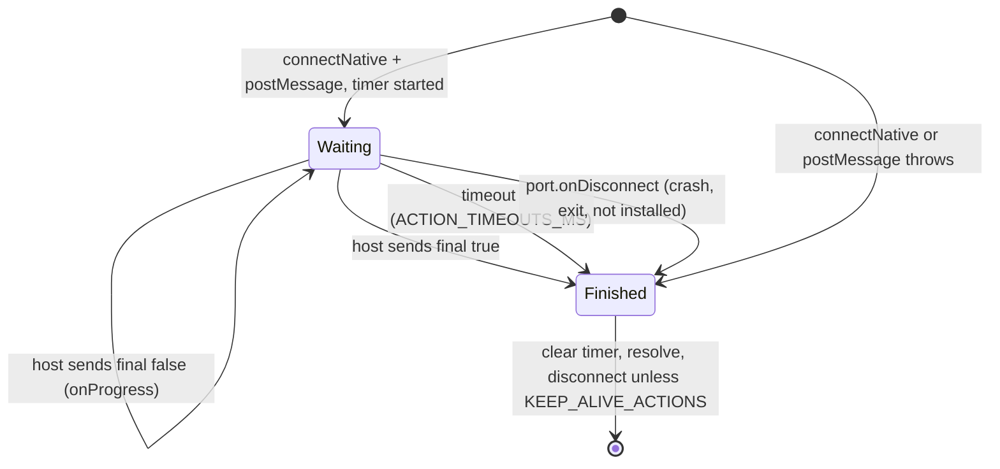

### 5.2 `sidebar.js`

| Area                             | Behaviour                                                                                                                                                                                                                   |
|----------------------------------|-----------------------------------------------------------------------------------------------------------------------------------------------------------------------------------------------------------------------------|
| Request tracking                 | `sendNativeAction(message, onResponse)` generates a `requestId` and stores the callback in `pendingRequests`. The `runtime.onMessage` listener dispatches each response by `requestId` and removes the entry on `final`.    |
| App status                       | `checkHost()` sends `get_version` on every open. Intermediate responses (repairs running) and a final warning/error show in the persistent `#hostNotice`, with the installer link when `helpUrl` is set; success hides it.  |
| URL field                        | `syncUrlFromActiveTab()` mirrors the active tab's URL when `isKnownSiteUrl` accepts it, on tab switch and in-page navigation. Skipped once the user types a URL (`autofilledUrl` tracks the last autofilled value).         |
| Folder field                     | `loadFolder()` uses `storage.local.lastFolder`; if unset, requests `get_current_folder` and stores the result. Manual edits are saved on `change`; an empty value removes the key. Context-menu downloads use the same key. |
| Download button                  | Accepts any http(s) URL (`isWebUrl`), sends `download`. Intermediate responses show as info/warning, the final one as success/error.                                                                                        |
| Open in app button               | Sends `download_gui` with whichever fields are filled.                                                                                                                                                                      |
| Choose button                    | Sends `select_folder` with the current folder field, so cancelling keeps it.                                                                                                                                                |
| `showResult()` / `clearResult()` | Status pill. A successful download gets "Show in folder" and "Play" (`fileActions`) and stays until the next result; other successes hide after 5 s.                                                                        |

### 5.3 `youtube.js`

- `isYouTubeUrl(value)`: http(s) on `youtube.com`, `www.`, `m.`, `music.` or `youtu.be`,
  with path `/watch?v=…`, `/shorts/…`, `/live/…`, or a non-empty `youtu.be/<id>`.
- `isKnownSiteUrl(value)`: a YouTube video or a track on `AUDIO_SITES` (SoundCloud
  `/<user>/<track>` and `on.soundcloud.com` share links, `<artist>.bandcamp.com/track/…`,
  Mixcloud `/<user>/<show>`). These get the context menu (whose `targetUrlPatterns` must
  cover them) and fill the sidebar's URL field.
- `isWebUrl(value)`: any http(s) URL, what the sidebar accepts when pasted (yt-dlp knows
  many sites and reports the ones it can't download).

The host validates more loosely (`core.is_web_url`: http(s) with a host name, which also
keeps a URL from being read as a yt-dlp option).

---

## 6. Native host

### 6.1 Module dependencies

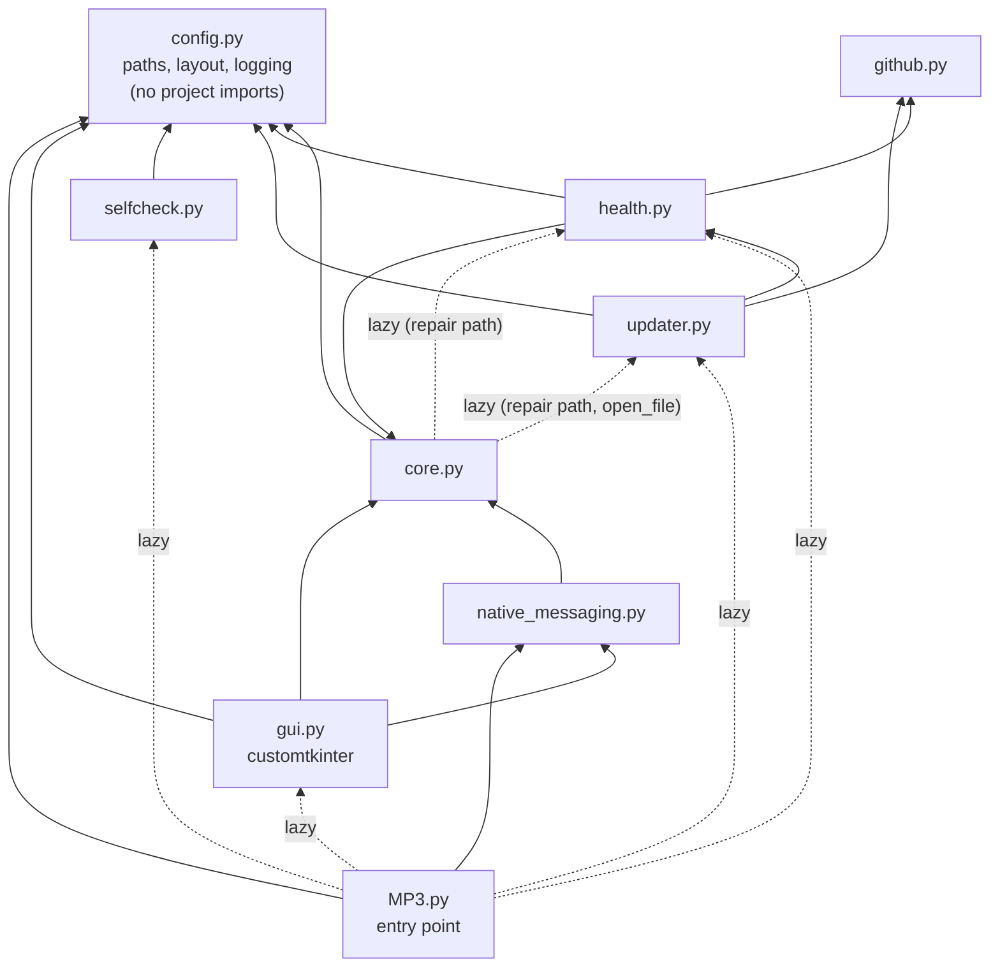

Arrows point from importer to imported. `MP3.py` is the only entry point. The dotted
imports are PEP 810 `lazy from … import` / `lazy from ytmp3_host import …` (module level,
Python 3.15): they load on first use, so a headless `download` never loads customtkinter,
Tk or urllib, and `core` can lazily import `health`, which imports `core`.

### 6.2 `config.py`

Installed layout (`mp3_installer.iss`):

```
%LOCALAPPDATA%\YouTube MP3 Downloader\      INSTALL_DIR: what the host manages at runtime, shared by all versions
    yt-dlp.exe                              YT_DLP_PATH, kept current by updater.py
    deno.exe                                DENO_PATH, only once a download needed it
    mp3.log, mp3.log.1                      LOG_PATH
    update.lock                             UPDATE_LOCK_PATH
    unins000.exe, unins000.dat              Inno Setup uninstaller
    versions\2.0.0\                         BIN_DIR: what the installer ships
        mp3.exe  _internal\  ffmpeg.exe  mp3.ico
```

| Mode                        | Detection                                         | `BIN_DIR` (ffmpeg, icon)      | `INSTALL_DIR` (yt-dlp, Deno, lock) | Log                       | `INSTALLED` |
|-----------------------------|---------------------------------------------------|-------------------------------|------------------------------------|---------------------------|-------------|
| Installed                   | frozen, and the exe's parent folder is `versions` | the version folder            | its grandparent                    | `INSTALL_DIR`, ERROR      | true        |
| PyInstaller build run as is | frozen, any other folder (e.g. `dist\mp3\`)       | the exe's folder              | the exe's folder                   | the exe's folder, ERROR   | false       |
| Source checkout             | not frozen                                        | `host/bin/` (placed manually) | `host/bin/`                        | repo root + stderr, DEBUG | false       |

In a source checkout the icon comes from `packaging/assets/`. Only an installed host can
update itself (`update_host` refuses otherwise). `DEFAULT_FOLDER` is
`YT-MP3-Downloads` in the user's real Documents folder (`documents_folder()`, asked from
Windows with `SHGetKnownFolderPath`, so a Documents folder moved into OneDrive is found;
`~/Documents` if that fails). Hosts before 2.1.0 used `~/Documents`; sidebar users keep
that folder, because the sidebar saved it as `lastFolder` on its first open.

`setup_logging()` (called once from `MP3.py`'s `__main__`) writes one rotating `mp3.log`
(1 MB, plus `mp3.log.1`). The `YTMP3_LOG_LEVEL` environment variable overrides the level
(e.g. `DEBUG` to debug an installed copy). The level applies to the `ytmp3_host` loggers;
third-party libraries log WARNING and up. Every module logs through
`logging.getLogger(__name__)`; `MP3.py` names its logger `ytmp3_host.MP3`, because its
`__name__` is `__main__`.

### 6.3 `MP3.py`

`ACTIONS` maps each action name to a handler taking the request dict.

| Handler              | Behaviour                                                                                                             |
|----------------------|-----------------------------------------------------------------------------------------------------------------------|
| `download`           | `native_messaging.run_native(url, folder, filename)`                                                                  |
| `download_gui`       | `gui.open_gui(...)`, then `sys.exit(0)` once the window is closed (the port is kept open, so stdin never reaches EOF) |
| `select_folder`      | `gui.select_folder(folder)`                                                                                           |
| `get_current_folder` | `send_current_folder("")`: the default folder, created if missing                                                     |
| `show_in_folder`     | `run_open_file(path, select=True)`                                                                                    |
| `play`               | `run_open_file(path, select=False)`                                                                                   |
| `get_version`        | `updater.remove_installed_downloads()`, then `health.host_status()`                                                   |
| `update_yt_dlp`      | `updater.update_yt_dlp()` (bound as `install_yt_dlp`); `UpdateError` becomes a final error                            |
| `update_host`        | `updater.update_host()` (bound as `install_host_update`); `UpdateError` becomes a final error                         |

Started as `mp3.exe --self-check` (`SELF_CHECK_ARG`), it runs `selfcheck.self_check()`
and exits with its code instead of serving requests. Firefox starts the host with other
arguments (the manifest path and the extension ID).

**`main()` request loop.**

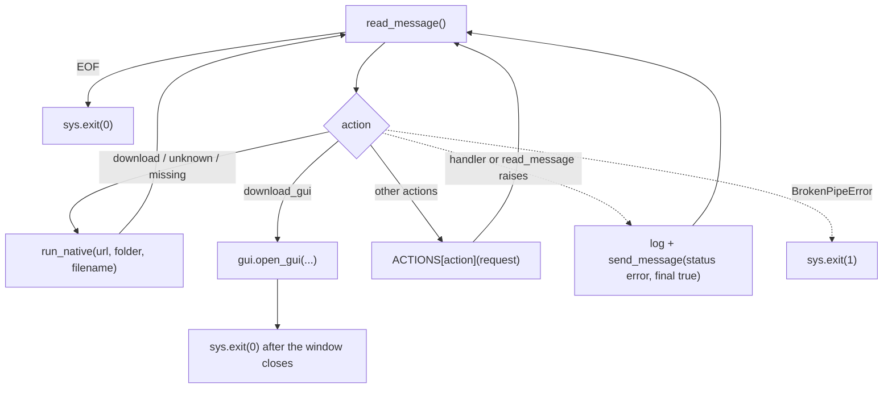

`send_message` exits the process itself if stdout is gone, so an error response can
never loop.

### 6.4 `gui.py`

`DownloaderApp(ctk.CTk)` is the window. Tk is not thread-safe: Tk variables are read on
the main thread only, and the worker thread changes widgets only via `self.after(0, …)`.

| Function                                                    | Behaviour                                                                                                                                                                                                                                                                                                                                                             |
|-------------------------------------------------------------|-----------------------------------------------------------------------------------------------------------------------------------------------------------------------------------------------------------------------------------------------------------------------------------------------------------------------------------------------------------------------|
| `open_gui(url, folder, filename)`                           | Builds the window and calls `run_native_gui`.                                                                                                                                                                                                                                                                                                                         |
| `run_native_gui(url, folder, filename)`                     | Pre-fills the fields. Invalid folder → the default folder is kept, the window's status label and the final `"GUI opened, folder not found …"` message say so. Schedules the final response (100 ms) and blocks in `mainloop()`.                                                                                                                                       |
| `start_download()`                                          | Main thread: validates URL (`is_web_url`) and folder (`resolve_folder`), switches the button to Cancel (so a second click cannot start a second download), then starts `_download_thread` with the values.                                                                                                                                                            |
| `_download_thread(url, folder_path, filename, download_id)` | Calls `core.download_with_repair` with `on_progress` (progress bar), `on_start` (remembers the process for cancel; kills it if Cancel was clicked before yt-dlp started), `on_info` (repair messages) and `is_cancelled`. Shows the result. Once a newer download started (`download_id` changed), a canceled thread that is still repairing leaves the window alone. |
| `show_saved(mp3_path, warnings)`                            | The "Saved" status with "Show in folder" and "Play" below it (`core.show_in_folder`, `core.open_file`).                                                                                                                                                                                                                                                               |
| `cancel_download()`                                         | Sets `download_cancelled`, kills the yt-dlp tree, resets the UI, starts `cleanup_partial_downloads()` on a thread.                                                                                                                                                                                                                                                    |
| `cleanup_partial_downloads(temp_stem)`                      | Waits 2 s, then `core.remove_temp_files` (fallback; `download_audio` already cleans up on exit).                                                                                                                                                                                                                                                                      |
| `reset_fields()`                                            | Clears URL and filename and restores the "Download MP3" button.                                                                                                                                                                                                                                                                                                       |
| `select_folder(folder)`                                     | Hidden topmost root + `askdirectory` starting at `folder` (else the default). Sends the selection, or the start folder on cancel.                                                                                                                                                                                                                                     |

Main button states:

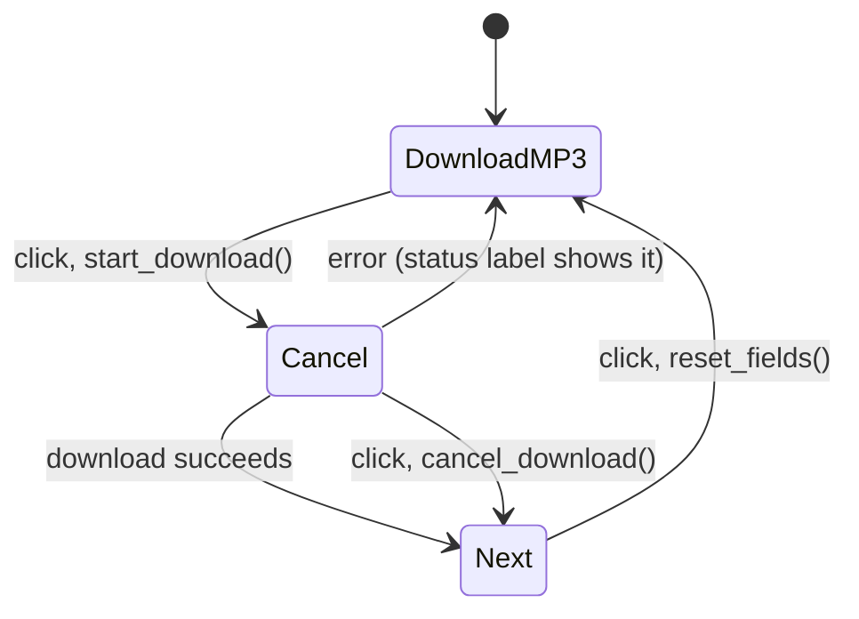

### 6.5 `native_messaging.py`

`read_message()` / `send_message()`: see §3.2. `send_current_folder(folder)` answers the
folder actions via `core.resolve_folder`. `run_open_file(path, select)` handles
`show_in_folder` / `play`.

`run_native(url, folder, filename)` handles a headless `download`:

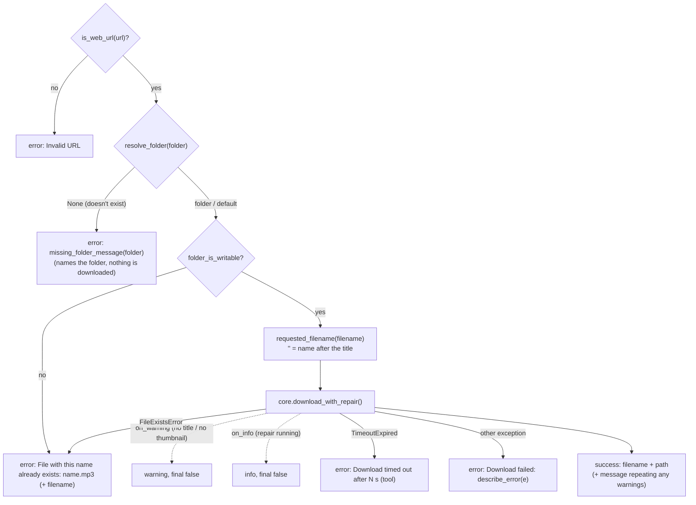

Error texts come from `core.describe_error`, shared with the GUI: yt-dlp failures show
yt-dlp's own last `ERROR:` line (e.g. "This video is unavailable"), never the command line.

### 6.6 `core.py`

| Function                                                                            | Behaviour                                                                                                                                                                                                                                                                                                                                                                                                                          |
|-------------------------------------------------------------------------------------|------------------------------------------------------------------------------------------------------------------------------------------------------------------------------------------------------------------------------------------------------------------------------------------------------------------------------------------------------------------------------------------------------------------------------------|
| `is_web_url(url)`                                                                   | The request check: http(s) with a host name.                                                                                                                                                                                                                                                                                                                                                                                       |
| `is_youtube_url(url)`                                                               | Substring check for `youtube.com` / `youtu.be/`. Only decides whether a failure may need Deno (other sites also print "Requested format is not available").                                                                                                                                                                                                                                                                        |
| `safe_filename(name)`                                                               | Strips `\/*?:"<>\|` and control characters; removes bracket groups made only of noise words (`NOISE_WORDS`: `Official`, `Music`, `Video`, `HD`, `Lyrics`, `Live`, …), e.g. `(Official Music Video)`, `[HD]`, while noise words elsewhere stay (`Live and Let Die`); removes empty `()`/`[]`; collapses whitespace; prefixes Windows device names (`CON`, `NUL`, `COM1`, …) with `_`. Empty → `DEFAULT_FILENAME` (`"Youtube MP3"`). |
| `requested_filename(name)`                                                          | `safe_filename`, but returns `""` when nothing meaningful is left, meaning "name it after the title".                                                                                                                                                                                                                                                                                                                              |
| `ensure_default_folder()`, `resolve_folder(folder)`                                 | Empty or the default folder → the (created) default folder; an existing directory → itself; otherwise `None`.                                                                                                                                                                                                                                                                                                                      |
| `title_filename(info)`                                                              | The name of a file named after its title. A title without a spaced dash gets the site's `artists` in front ("Forss - Flickermood"), never the channel (a vlog stays "Me at the zoo").                                                                                                                                                                                                                                              |
| `artist_for(filename, info)`                                                        | The text before the first spaced dash (` - `, ` – `, ` — `) in the filename, else before the first `-`; without a dash the video's `artists` (`info_artists`, which ignores Mixcloud's: a mix's tracklist), else the channel without " - Topic", else the uploader, else `<unknown>`. The title tag is the text after the dash (`title_from_filename`).                                                                            |
| `extra_tags(info)`                                                                  | Album, year (`release_year` only: an official video's upload year is often decades after the song), track number, the video URL as the comment; each only when the video has it.                                                                                                                                                                                                                                                   |
| `download_audio(url, folder, filename, on_progress, on_start, on_warning, timeout)` | The single pipeline (§6.7). Verifies the final MP3 exists before returning it. Raises `FileExistsError`, `FileNotFoundError` (ffmpeg/yt-dlp missing, no MP3 produced), `TimeoutExpired`, `CalledProcessError`. Temp files are always removed.                                                                                                                                                                                      |
| `download_with_repair(...)`                                                         | `download_audio`, retried once after a yt-dlp failure that a repair may fix (§7.6). Used by both the headless and the GUI path.                                                                                                                                                                                                                                                                                                    |
| `describe_error(error)`                                                             | One-line user message for a `download_audio` exception (headless and GUI).                                                                                                                                                                                                                                                                                                                                                         |
| `embed_thumbnail(temp_mp3, thumb, artist, title, output, tags)`                     | One ffmpeg pass (50 s timeout): audio copied, thumbnail center-cropped 1:1 as JPEG `-q:v 2`, ID3v2.3, artist, title and `tags`. Writes `output` directly, removes it on failure. Raises `FileExistsError` itself if `output` exists: ffmpeg 7 exits 0 when `-n` refuses to overwrite.                                                                                                                                              |
| `kill_process_tree(process)`                                                        | `taskkill /F /T`; yt-dlp.exe is a onefile build, `Popen.kill()` only stops its bootloader.                                                                                                                                                                                                                                                                                                                                         |
| `remove_temp_files(temp_stem)`, `remove_stale_temp_files(folder)`                   | Delete `<temp_stem>.*`, retrying files Windows still locks after a kill; before each download, delete `_ytmp3_*` files older than 1 h that a killed host left behind.                                                                                                                                                                                                                                                              |
| `downloaded_mp3(path)`, `show_in_folder(file)`, `open_file(file)`                   | File actions. Show uses `SHOpenFolderAndSelectItems` (`explorer /select,` splits the path at commas). Play runs `explorer.exe "<path>"` via `updater.launch_detached`, so the player is not ended with the host.                                                                                                                                                                                                                   |

### 6.7 Download pipeline

```
yt-dlp.exe --no-playlist --playlist-items 1 --concurrent-fragments 3
           -x --audio-format mp3 --audio-quality 0
           --write-thumbnail
           --ffmpeg-location <ffmpeg.exe>
           --print before_dl:YTMP3_INFO:%(.{title,artists,album,release_year,track_number,channel,uploader,webpage_url,extractor_key})j
           --no-simulate
           --progress --newline --encoding utf-8
           [--js-runtimes deno:<INSTALL_DIR>\deno.exe]      only once the host installed Deno
           -o "<folder>/_ytmp3_<hex>.%(ext)s"
           <url>
```

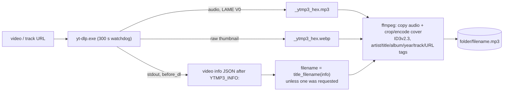

- One yt-dlp call, one ffmpeg pass. MP3 is always LAME V0 (`--audio-quality 0`, which
  encodes as fast as the default V5); the cover is a high-quality JPEG (`-q:v 2`).
- Output goes to a unique temp stem, so the title is only needed after the download; there
  is no separate `--get-title` call. With a requested filename the "already exists" check
  runs before anything starts. Named after the title, the check runs when the info prints
  (`before_dl`), before any audio is downloaded, and again after the download.
- `--print` would make yt-dlp a dry run without `--no-simulate`, and implies `--quiet`, so
  `--progress` keeps the progress lines.
- `--playlist-items 1` keeps a playlist URL (SoundCloud set, Bandcamp album) to one file.
- The watchdog kills the whole tree after `DOWNLOAD_TIMEOUT_S`; a callback that raises
  also kills it. `[download]` progress lines are left out of the error output, so the
  warnings `download_with_repair` looks for stay in it.

---

## 7. Versions, updates and repairs

The main goal of v2: users never have to reinstall by hand. The extension updates itself
through AMO; the host updates itself and its tools from GitHub. Every step is built so
that a lost connection, a killed process or a broken release leaves a working host behind,
because a host that can't start can't repair itself.

### 7.1 Versions and the handshake

- The host version is `ytmp3_host.__version__`; `pyproject.toml` and `MyAppVersion` in the
  installer repeat it (`test_versions.py` checks they match).
- `MIN_HOST_VERSION` in `background.js` is the oldest host the extension works with. It is
  a minimum, not an exact match: raise it only when the extension starts to rely on a new
  host action or field, and never above the released host version (checked by a test).
- The sidebar sends `get_version` on every open. The host answers with facts only
  (`health.host_status`, §4.2): the yt-dlp version check (`yt-dlp --version`, killed after
  20 s) runs while the two GitHub lookups (`github.latest_release_tag`, one HEAD request to
  `/<repo>/releases/latest`, reading the tag from the redirect, so no API rate limit) run
  in worker threads.
- 1.x hosts don't know `get_version`: they treat it as a download without a URL and answer
  "Invalid YouTube URL" (`LEGACY_HOST_REPLY`), which marks them as a host that can't
  update itself.

`assessHostStatus` turns the last answer into one status for `#hostNotice`. Every problem
comes with the installer link (`INSTALLER_URL`, the latest release's
`YT-MP3-Downloader-Setup.exe`), which fixes every host problem:

| Answer                                              | Status shown                                                              |
|-----------------------------------------------------|---------------------------------------------------------------------------|
| "No such native application"                        | error: not installed                                                      |
| port closed without an answer                       | error: not working, reinstall (a broken install)                          |
| "Invalid YouTube URL" without `version`             | warning: this (1.x) version can't update itself, install the new one once |
| any other error without `version` (e.g. timeout)    | that error                                                                |
| `version` below `MIN_HOST_VERSION`                  | warning: out of date                                                      |
| ffmpeg missing                                      | error                                                                     |
| yt-dlp missing / not working                        | error                                                                     |
| yt-dlp outdated (the automatic update did not work) | warning                                                                   |
| all fine                                            | success (notice hidden); a failed host update turns it into a warning     |

A missing JavaScript runtime is reported but not shown: it is normal (§7.6). Reasons of
failed repairs are appended to the message.

### 7.2 Check and repair (`background.js`)

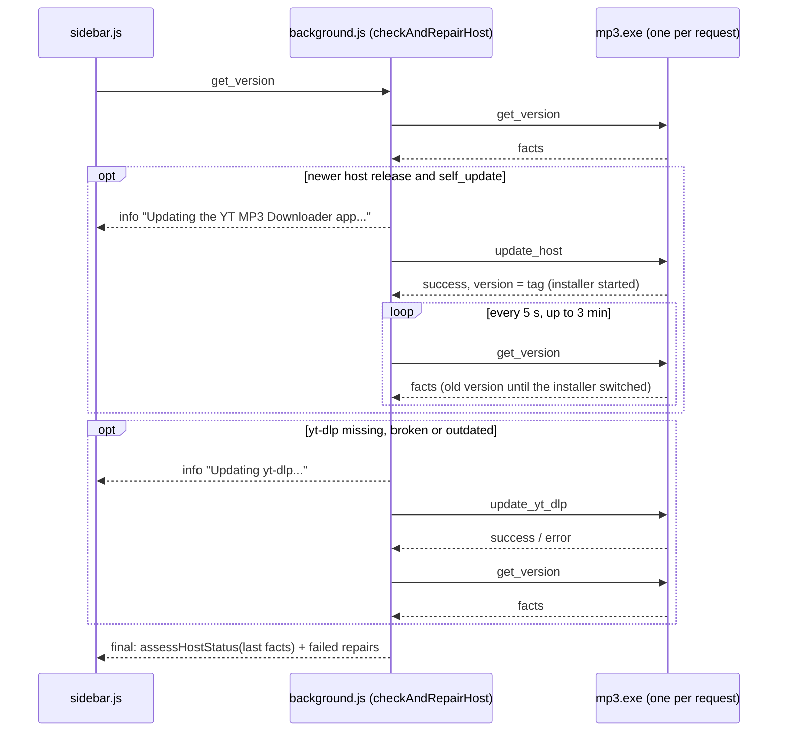

- `neededRepairs` asks for repairs only on a real answer of a v2+ host (`source` `host`
  and a `version`), most important first: `update_host` (when `outdated` and
  `self_update`: a new release may bring its own fixes), then `update_yt_dlp`. Each repair
  runs at most once per check, even if it did not help.
- Unknown values (`null`, e.g. offline) never trigger a repair.
- Concurrent checks (two windows) share one run (`checkHost`); a caller that joins it gets
  the last progress message at once, then the later ones and the final answer.
- Users who never open the sidebar are checked in the background (`checkHostInBackground`),
  at most once a day: 1 min after the browser starts (not during its startup) and after a
  context-menu download (after it, so it never delays the download). Any check counts, the
  sidebar's too; its start time is kept in `storage.local.lastHostCheck`, so restarts don't
  add checks. It shows nothing: what it can't repair, the sidebar shows when it opens.

### 7.3 yt-dlp updates (`updater.update_yt_dlp`)

Rules shared by every update (yt-dlp, Deno, host):

- Every file comes from one release tag, the one `latest_release_tag` returned, so a file
  and its checksum always match. A tag that is not a version (e.g. the 1.x style `v-1.1`)
  is refused.
- A download goes to a temp name and is checked against the SHA-256 the release publishes
  (yt-dlp: `SHA2-256SUMS`, host: `SHA256SUMS`, Deno: `<asset>.sha256sum`) before anything
  uses it. `download()` also checks `Content-Length` (a dropped connection can end the body
  without an error), enforces a deadline and a size limit, and fsyncs the file.
- One update at a time: `update_lock()` is a Windows byte-range lock on `update.lock`.
  Windows drops it when the process dies, so there are no stale locks. A second host
  waits up to 60 s.
- `UpdateError` carries a message meant for the user; the installed tool is left as it was.

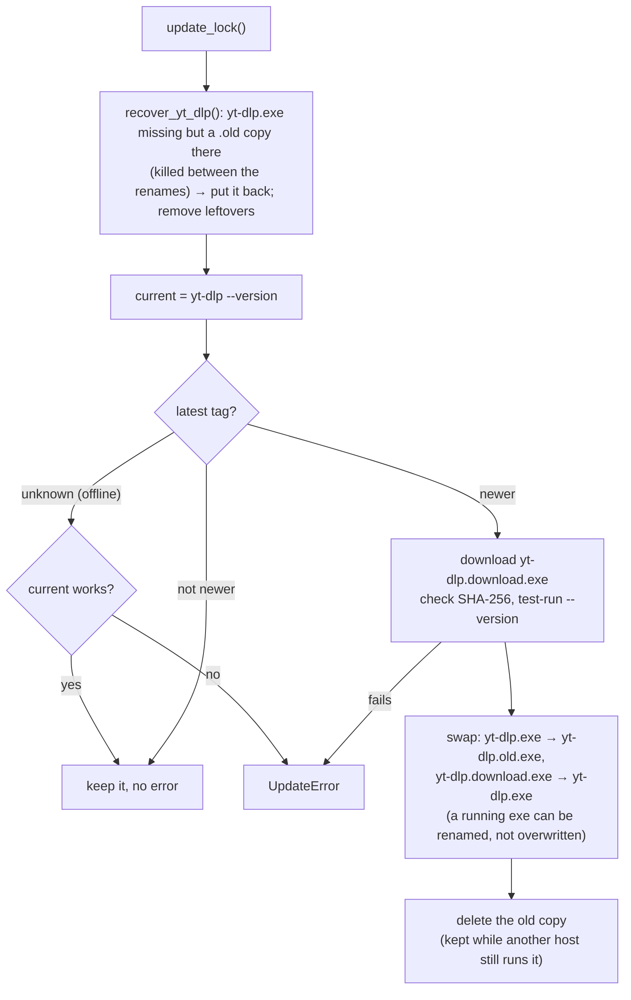

- If the second rename fails (e.g. a virus scanner holds the new file), the old copy is
  renamed back. An `.old` copy still running in another host can't be deleted; a later
  update removes it, and meanwhile a swap uses a unique `.old-<hex>` name.
- It also removes the leftovers of a killed Deno install.

### 7.4 Host self-update (`updater.update_host`)

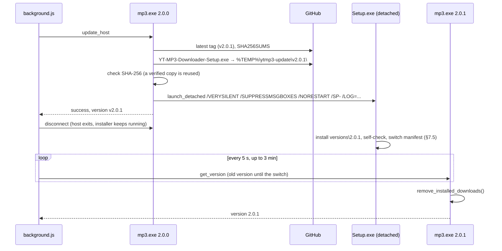

- Refused in a source checkout or a build run from `dist\` (`config.INSTALLED`).
- The installer breaks away from Firefox's job object (`CREATE_BREAKAWAY_FROM_JOB`), so
  Firefox doesn't kill it with the host; without breakaway permission it is started
  inside the job and may not survive (then the update never arrives and the user gets the
  manual link). It starts in the temp folder, so it doesn't hold the old version folder
  as its working directory.
- A started installer is not started again for 10 min (`INSTALL_GRACE_S`, a `started`
  marker in the download folder that holds the installer's SHA-256); `update_host` then
  just returns the tag. After that the host is still outdated, so the install failed: the
  same installer is retried only 24 h after its start (`INSTALL_RETRY_S`), and until then
  `update_host` fails at once (the sidebar shows the installer link, without 3 min of
  "Updating..."). A release re-published under the same tag has a new installer, which
  is started right away.
- `remove_installed_downloads()` runs on every `get_version`: it deletes the download
  folders of this release and older ones, keeping a newer release's download (its
  installer may be about to run, and its `install.log` explains a failed update). Files
  the still-finishing installer holds open are retried on the next call.

### 7.5 Installer (`mp3_installer.iss`)

Per-user (`PrivilegesRequired=lowest`), x64 and ARM64 (emulated) only. The same script
serves a first install, a manual reinstall, an upgrade from 1.x and the silent self-update.

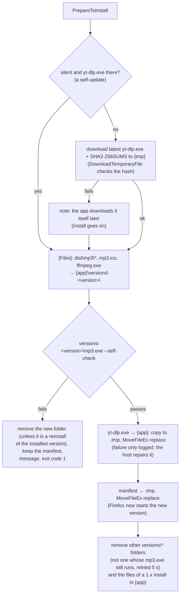

- **Never a half-installed host.** Each version gets its own folder. Firefox is switched
  only after all its files (and yt-dlp) are in place and the self-check passed, in one
  atomic step. A kill or power loss before the switch leaves Firefox on the old, complete
  version. `CloseApplications=no`: a new version never touches files a running host uses.
- **Self-check** (`selfcheck.py`): imports every host module (`MODULES`; the lazy imports
  would only fail on first use, and a test checks the list is complete), starts a second
  process of the same version the way Firefox does (`host_command`) and expects exactly
  one framed answer to `ping`, checks that HTTPS works (`ssl`, which the updater needs),
  and runs the ffmpeg steps of a download on a generated 1 s tone and image in a temp
  folder (libmp3lame V0 encode, then the real `core.embed_thumbnail`; the result must have
  the ID3v2.3 artist, title and cover frames). All offline, about 1 s, so no test URL can
  go stale. Exit code 0 or 1; problems go to `mp3.log` and stderr. yt-dlp is not checked:
  all versions share it and the host repairs it.
- yt-dlp is downloaded, not bundled (YouTube changes break old versions), except in a
  silent update that finds one: the host keeps that one current.
- A version folder whose `mp3.exe` still runs (e.g. a GUI window open during the update)
  is kept and removed by the next update or the uninstaller.
- 1.x installed `mp3.exe` (onefile), `ffmpeg.exe` and `mp3.ico` directly in `{app}`,
  under the same AppId and folder; they are removed after the switch.
- **Uninstall** removes the registry key, the manifest, `versions\`, and what the host
  created at runtime (`yt-dlp*.exe` leftovers, `deno.exe`, `update.lock`, `mp3.log*`),
  listed under `[UninstallDelete]` because they are not in `[Files]`. The default download
  folder is removed only if it is empty (`dirifempty`, so the user's MP3s are never
  deleted), under both `{userdocs}` (the real Documents folder, where the host creates it
  since 2.1.0; different when Windows moved it, e.g. into OneDrive) and
  `%USERPROFILE%\Documents` (where older hosts created it).

### 7.6 Repair during a download (`core.download_with_repair`)

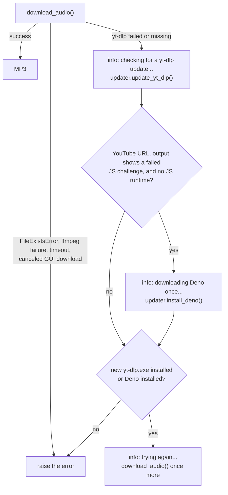

- Runs in the host, so sidebar, context-menu and GUI downloads all get it, and the
  updater only loads on this failure path.
- Deno (`updater.install_deno`): the latest `denoland/deno` release's
  `deno-x86_64-pc-windows-msvc.zip`, checked against its `.sha256sum` (PowerShell
  `Get-FileHash` format, so the hash is found by regex), unpacked to `deno.download.exe`,
  test-run with `deno eval`, renamed to `deno.exe`. It is passed to yt-dlp as
  `--js-runtimes deno:<path>` (yt-dlp only searches PATH). It costs ~5.5 s per download,
  so it is never installed up front, and it is never updated afterwards (like ffmpeg).

### 7.7 What happens when something goes wrong

| Situation                                                     | Result                                                                                                       |
|---------------------------------------------------------------|--------------------------------------------------------------------------------------------------------------|
| Offline during a check                                        | `latest`/`outdated` are `null`, nothing is repaired, no notice.                                              |
| Host killed mid-download of an update                         | Only a temp file is left (`yt-dlp.download.exe`, `*.download`); the next update removes it.                  |
| Host killed between the two yt-dlp renames                    | `yt-dlp.exe` missing, `.old` copy there: the next update (or repair) puts it back, offline too.              |
| Two hosts update at once                                      | The second waits for the lock, then finds yt-dlp current and downloads nothing.                              |
| Download truncated or damaged, or the release lacks checksums | Checksum or size check fails, nothing is installed, the user is told why.                                    |
| Release published but its assets not uploaded yet             | The update fails this time (no `SHA256SUMS`) and works on a later check. Publish releases with their assets. |
| Installer killed (or power loss) before the manifest switch   | Firefox stays on the old, complete version; the next update reinstalls the new folder.                       |
| New release broken (self-check fails)                         | Not switched, folder removed, Setup exits 1; users stay on the old version. Publish a fixed release.         |
| The new version never answers within 3 min                    | Warning with the manual installer link; a later check sees whatever version is installed then.               |
| Firefox closed during a self-update                           | The installer keeps running (it broke away from Firefox's job).                                              |
| Manifest or host files broken (any reason)                    | "Not working / not installed" with the installer link: a manual install fixes every host problem.            |

---

## 8. Request flows

### 8.1 Sidebar download (headless)

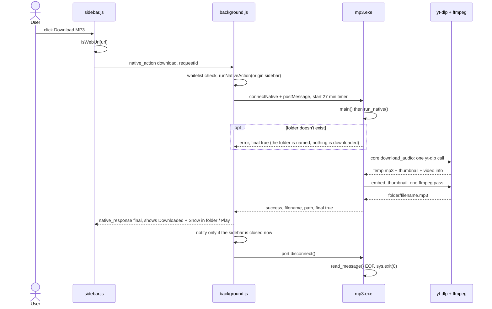

If yt-dlp fails, the host repairs and retries before its final answer (§7.6), sending
`info` messages meanwhile.

### 8.2 Open in app (GUI)


After `"GUI opened"`, the GUI reports nothing back to the extension.

### 8.3 Context-menu download

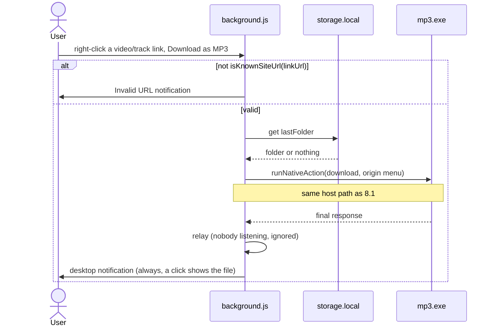

### 8.4 Folder actions

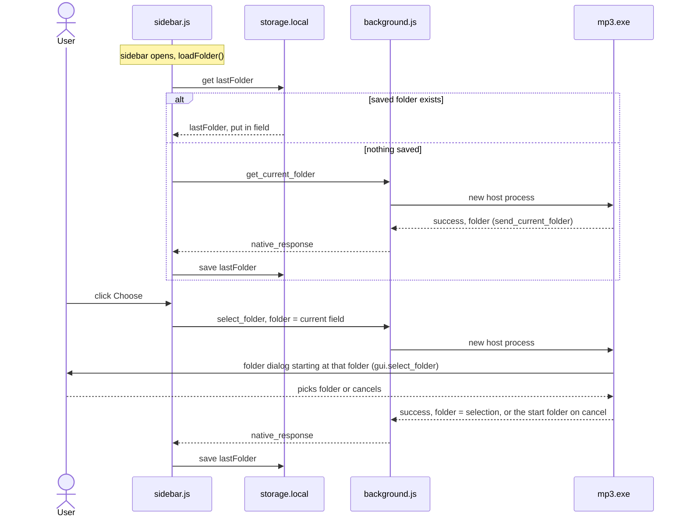

Cancelling the dialog keeps the previously selected folder. `get_current_folder` creates
the default folder if it does not exist yet.

---

## 9. Build and release

```mermaid
flowchart LR
    SRC["host/src/ytmp3_host/*.py"] -- "uv run pyinstaller --onedir<br/>--name mp3 --icon mp3.ico MP3.py" --> EXE["dist/mp3/mp3.exe<br/>+ _internal/"]
    EXE --> ISS["packaging/installer/<br/>mp3_installer.iss<br/>(Inno Setup 6)"]
    FFB["host/bin/ffmpeg.exe"] --> ISS
    ICO["packaging/assets/mp3.ico"] --> ISS
    ISS --> SETUP["packaging/installer/output/<br/>YT-MP3-Downloader-Setup.exe"]
    SETUP -- "write_checksums.py" --> SUMS["SHA256SUMS"]
    SETUP --> REL["GitHub release vX.Y.Z"]
    SUMS --> REL
    EXT["extension/"] -- "zip" --> AMO["AMO upload"]
```

- `--name mp3`: installed manifests point at `mp3.exe`. `--onedir`, not `--onefile`:
  onefile unpacks itself to a temp folder on every launch, and every request starts a new
  host process.
- Installed hosts update themselves from the latest GitHub release, so a release is a
  deployment. Release checklist (also in `CLAUDE.md`):
  1. Bump the host version (`__version__`, `pyproject.toml`, `MyAppVersion`).
  2. Build with PyInstaller; optionally run `dist\mp3\mp3.exe --self-check` (with
     `ffmpeg.exe` copied next to it). Compile the installer.
  3. `uv run python packaging/write_checksums.py packaging/installer/output/YT-MP3-Downloader-Setup.exe`
  4. Publish a GitHub release tagged `vX.Y.Z` with both files under exactly these names.
     The updater never installs a release without `SHA256SUMS`, and the extension's
     installer link is `releases/latest/download/YT-MP3-Downloader-Setup.exe`, so the
     latest release must always carry it. Create it as a draft, upload both files, then
     publish. A pre-release is never "latest", so it can be staged and tested first.
  5. Publish the host release before an extension version that needs it goes to AMO.
- The extension is versioned separately (`manifest.json` `version`, which must be above
  the version on AMO).

---

## 10. Development workflow

| Task                              | How                                                                                                                                                                                                                                                                                                                                                |
|-----------------------------------|----------------------------------------------------------------------------------------------------------------------------------------------------------------------------------------------------------------------------------------------------------------------------------------------------------------------------------------------------|
| Python environment                | `uv sync`; place `ffmpeg.exe` and `yt-dlp.exe` in `host/bin/`.                                                                                                                                                                                                                                                                                     |
| Register a dev host               | Copy `packaging/app_manifest.dev.json` to `%APPDATA%\Mozilla\NativeMessagingHosts\app_manifest.json`, set `path` to your `dist\mp3\mp3.exe` (copy `ffmpeg.exe`, `yt-dlp.exe`, `mp3.ico` next to it), remove the `"\\"` comment key, and create the `HKCU` key from §3.1 (or run the installer once). A build run from `dist\` can't update itself. |
| Test host changes through Firefox | Rebuild `mp3.exe` with PyInstaller; the manifest points at an executable.                                                                                                                                                                                                                                                                          |
| Test the host without Firefox     | `uv run python host/tests/smoke_native.py`. Sends one hard-coded message to `dist/mp3/mp3.exe` (fallback: `python -m ytmp3_host.MP3`) and prints the reply. Edit `message` to change the action. Not pytest-safe: calls yt-dlp at import.                                                                                                          |
| Debug an installed host           | Set the `YTMP3_LOG_LEVEL=DEBUG` environment variable for Firefox, then read `%LOCALAPPDATA%\YouTube MP3 Downloader\mp3.log`. A self-update's installer log is `%TEMP%\ytmp3-update\<tag>\install.log`.                                                                                                                                             |
| Load the extension                | `about:debugging` → Load Temporary Add-on → `extension/manifest.json`.                                                                                                                                                                                                                                                                             |
| Extension tests                   | `node --test tests/extension/`                                                                                                                                                                                                                                                                                                                     |
| Host tests                        | `uv run pytest` (ffmpeg tests need `ffmpeg.exe` in `host/bin/` or on `PATH`, else they are skipped). `uv run pytest -m network` runs one real download with `dist/mp3/yt-dlp.exe`.                                                                                                                                                                 |
| Type check                        | `uv run pyrefly check` (keep it at 0 errors; `project-includes` in `pyproject.toml` makes it check `host/`).                                                                                                                                                                                                                                       |

### 10.1 Extension tests

```mermaid
flowchart LR
    T["background.test.js<br/>host_status.test.js<br/>youtube.test.js"] --> H["harness.js<br/>loadBackground()"]
    H -- "node:vm sandbox" --> E["extension/youtube.js<br/>extension/background.js<br/>(real files)"]
    H -- "fake browser global" --> FB["runtime, contextMenus,<br/>notifications, sidebarAction,<br/>storage.local"]
    FB --> FP["fake ports<br/>reply() = host message<br/>exit() = host disconnect"]
```

`background.test.js` covers the request lifecycle: single final response, keep-alive,
timeouts, disconnect errors, notifications, context menu. `host_status.test.js` covers the
check-and-repair: version parsing, every status of §7.1, each repair at most once, the
host-update wait, shared concurrent checks. `youtube.test.js` covers the URL checks.
`sidebar.js` has no automated tests.

### 10.2 Host tests

pytest, in `tests/host/`. The rule: replace only what needs the network, the user's
folders or a real video; everything else runs for real. Real `Popen` and pipes, real
`taskkill /T`, the real request loop and framing, the real file system (inside pytest's
`tmp_path`), and the real `ffmpeg.exe` when available.

| File                      | Covers                                                                                                                  |
|---------------------------|-------------------------------------------------------------------------------------------------------------------------|
| `test_core_helpers.py`    | Filenames, artist and tags, folders, URL check, error messages.                                                         |
| `test_download_audio.py`  | `download_audio` with the fake yt-dlp: naming, warnings, errors, timeout and cleanup.                                   |
| `test_embed_thumbnail.py` | `embed_thumbnail` and the whole pipeline with the real ffmpeg (skipped without one).                                    |
| `test_repair.py`          | `download_with_repair` with fake repairs (yt-dlp update, Deno).                                                         |
| `test_native_host.py`     | The native-messaging contract through `MP3.main()` with real framed bytes, including the update actions.                |
| `test_health.py`          | The `get_version` facts.                                                                                                |
| `test_github.py`          | `latest_release_tag` against a local HTTP server that answers like github.com.                                          |
| `test_updater.py`         | yt-dlp updates and repairs, Deno, the host self-update, the lock and `launch_detached`, against a local release server. |
| `test_selfcheck.py`       | `--self-check`: modules, the `ping` round trip, HTTPS, the ffmpeg steps.                                                |
| `test_versions.py`        | Versions and names the host, the installer, the release and the extension must agree on; no new extension permissions.  |
| `test_network.py`         | Opt-in (`-m network`): a real download with the real binaries.                                                          |

**Fixtures** (`conftest.py`). Autouse: `default_folder` (`core.DEFAULT_FOLDER` →
`tmp_path/default`, not created up front), `no_github` (every latest release is unknown,
as offline, and any updater download raises, unless a test sets up its own server),
`update_paths` (the lock file and the installer download folder in `tmp_path`). On
request: `fake_yt_dlp` (dummy `YT_DLP_PATH` / `FFMPEG_PATH`, and `build_download_command`
wrapped to run `python fake_yt_dlp.py` with the real arguments), `fake_embed` (records
`embed_thumbnail`'s arguments and copies the temp MP3), `ffmpeg` and `media` (the real
binary from `host/bin/` or `PATH`, a generated 1 s MP3 and PNG). `core` imports its paths
by name, so they are patched on `core`, not on `config`.

**`fake_yt_dlp.py`** takes the real yt-dlp arguments (including `--version`), honors the
real `-o` and `--print` templates, prints yt-dlp-style progress lines, writes a
`.webm.part` file (so cleanup is tested), and acts according to `FAKE_YTDLP_MODE`:
`success` (default), `fail`, `hang` (a grandchild holds stdout open, like the onefile
bootloader's child, so `kill_process_tree` is tested), `no_title` / `no_thumb` /
`no_mp3`, `bad_version`, and `needs_js` (fails like YouTube wanting JavaScript, unless
given `--js-runtimes`). `FAKE_YTDLP_TITLE`, `FAKE_YTDLP_INFO`, `FAKE_YTDLP_VERSION`,
`FAKE_YTDLP_MP3` and `FAKE_YTDLP_THUMB` set what it prints and writes.

In `test_updater.py` / `test_github.py` the fake `yt-dlp.exe` downloads are small Python
scripts run as `python <file> --version`, so whether a download "runs" depends on its
content, like the real exe.

**Temp files.** Everything is written below `tmp_path`. `tmp_path_retention_policy =
"failed"` in `pyproject.toml` deletes the directories of passing tests after the run.

**Not covered:** `gui.py` (Tk), `setup_logging()`, the installer script (only the names
it shares with the host are checked).

**Adding a test:** use the fixtures above instead of real paths. Never write outside
`tmp_path`. A new yt-dlp behavior is a new `FAKE_YTDLP_MODE`. Anything that needs the
internet or the real binaries gets `@pytest.mark.network`.

---

## 11. Invariants and change checklist

**Invariants**

- No stdout output in host code other than `send_message`.
- Exactly one `final: true` response per request. Intermediate responses must set
  `final: false` explicitly.
- `ACTION_TIMEOUTS_MS` must stay above the host's worst case: `download` (27 min) above
  the yt-dlp call (300 s) + ffmpeg (50 s) + a yt-dlp update + Deno + one retry (about
  25 min); `update_yt_dlp` (7 min) above ~345 s; `update_host` (9 min) above ~485 s. The
  sums are in the comment above `ACTION_TIMEOUTS_MS`.
- `app_manifest`, `yt.downloader@converter.org`, `mp3.exe`, the installer's `AppName` and
  its output name are fixed (§3.1).
- No update ever leaves a broken tool or host (§7): download to a temp name, check the
  SHA-256, test-run, then switch in one step; a version folder is switched to only after
  its self-check passed.
- Download logic lives in `core.py` only; both the headless and the GUI path call
  `core.download_with_repair`.
- Nothing the headless path imports may import customtkinter, Tk or urllib at module
  level (a test checks it); use `lazy` imports.
- Tk is touched only from the main thread (`gui.py` worker threads use `after(0, …)`).
- Child processes get `stdin=DEVNULL`; yt-dlp is stopped with `kill_process_tree`.
- A `KEEP_ALIVE_ACTIONS` handler must exit the host itself when it is done.
- The extension never asks for a new required permission (§5).

**Adding a host action**

1. `ACTION_TIMEOUTS_MS` in `background.js` (whitelist + timeout).
2. `ACTIONS` dict in `MP3.py`.
3. Caller in `sidebar.js`.
4. `KEEP_ALIVE_ACTIONS` if the host must outlive its final response (then exit the host
   from the handler when done, like `download_gui`).
5. If the extension relies on it, raise `MIN_HOST_VERSION` (older hosts don't have it).
6. A test in `tests/extension/` if lifecycle behavior changes, and one in
   `tests/host/test_native_host.py` for the host's responses.
7. A new host module goes into `selfcheck.MODULES` (a test checks it).

**Changing yt-dlp arguments:** `core.build_download_command`. Measure download time
before and after (see the project priorities in `CLAUDE.md`), and never trade quality for
speed silently.

---

## 12. Known issues and limitations

| Issue                                                           | Details                                                                                                                                                                                                                                         |
|-----------------------------------------------------------------|-------------------------------------------------------------------------------------------------------------------------------------------------------------------------------------------------------------------------------------------------|
| Cancel right after the download starts can leave yt-dlp running | If `kill_process_tree` runs before yt-dlp.exe's bootloader has started its real child, only the bootloader dies. The orphan keeps the pipe open and the cancel waits until it finishes. Possible fix: kill the tree again after a short delay.  |
| Deno is never updated                                           | If a future yt-dlp needs a newer Deno, the failure path only installs a missing one (PLAN).                                                                                                                                                     |
| The installer is not code-signed                                | Firefox and SmartScreen warn on the manual download; the sidebar explains how to proceed. The silent self-update is not affected.                                                                                                               |

Resolved:

| Former issue                                                                                                                     | Resolution                                                                                                                                                                  |
|----------------------------------------------------------------------------------------------------------------------------------|-----------------------------------------------------------------------------------------------------------------------------------------------------------------------------|
| Updates ran only from the sidebar (2.0.0)                                                                                        | `checkHostInBackground` checks at most once a day, after startup and after a context-menu download (2.1.0).                                                                 |
| A broken release was started again on every sidebar open after the 10 min grace, with 3 min of "Updating..." (2.0.0)             | The same installer is retried only once a day (`INSTALL_RETRY_S`); meanwhile `update_host` fails at once (2.1.0).                                                           |
| A second sidebar during an update showed nothing until the end (2.0.0)                                                           | A sidebar that joins a running check gets its progress messages (2.1.0).                                                                                                    |
| A path with non-ASCII characters (e.g. an accented user name) broke the native-messaging manifest                                | The installer writes the manifest as ASCII with `\uXXXX` escapes (1.x wrote it in the ANSI code page).                                                                      |
| 1.x stopped the install when yt-dlp could not be downloaded                                                                      | The install goes on; the host downloads yt-dlp itself.                                                                                                                      |
| `get_current_folder` did not create the default folder                                                                           | `send_current_folder` uses `core.resolve_folder`, which creates the default folder when it is requested.                                                                    |
| Host lingered after `download_gui` (rejected folder, and also after the window was closed)                                       | An invalid folder opens the window with the default folder and says so (window + final message); `MP3.download_gui` exits the host when the window closes or fails to open. |
| Headless download only logged "file exists" / "ffmpeg missing"                                                                   | `core.download_audio` raises `FileExistsError` / `FileNotFoundError`, which `run_native` reports with a specific message.                                                   |
| `select_folder` cancel returned the default folder                                                                               | The sidebar sends its current folder; the picker starts there and returns it on cancel.                                                                                     |
| GUI read Tk variables from the download thread; double click could start two downloads; Cancel before yt-dlp started was ignored | Fixed in `gui.py` (§6.4).                                                                                                                                                   |
| `.part` files could survive a killed download (Windows locks)                                                                    | `core.remove_temp_files` retries locked files; `remove_stale_temp_files` removes what a killed host left.                                                                   |
| Error messages contained the raw yt-dlp command line                                                                             | `core.describe_error`.                                                                                                                                                      |
| ffmpeg 7 exits 0 when `-n` refuses to overwrite, so an existing file was reported as a fresh download                            | `embed_thumbnail` raises `FileExistsError` itself.                                                                                                                          |
| Noise-word removal cut real titles ("Live and Let Die" → "and Let Die"); "Jay-Z - Song" got the artist "Jay"                     | Only bracket groups made entirely of noise words are removed; the artist ends at the first spaced dash.                                                                     |
| Control characters and Windows device names (`CON`, `NUL`, …) passed through `safe_filename`                                     | Removed / prefixed with `_`.                                                                                                                                                |
