# Architecture

Technical reference for the extension, the native host, and the protocol between them.
For what the project does and how to install it, see `README.md`.

---

## 1. System overview

Two independently built and deployed components, connected only by Firefox native
messaging over stdio.

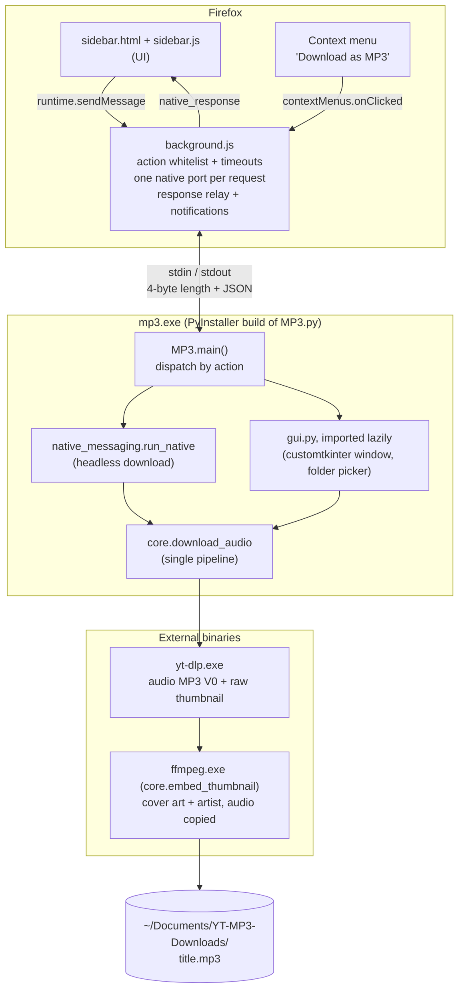

| Component   | Source                 | Language                                                        | Artifact                                                   | Distribution         |
|-------------|------------------------|-----------------------------------------------------------------|------------------------------------------------------------|----------------------|
| Extension   | `extension/`           | JavaScript, Manifest V2, plain scripts (no bundler, no modules) | Zip of `extension/`                                        | AMO                  |
| Native host | `host/src/ytmp3_host/` | Python ≥ 3.14                                                   | `dist/mp3/mp3.exe` + `_internal/` (PyInstaller `--onedir`) | Inno Setup installer |

The extension is a UI and message router only. All file system access, process
execution and dialogs live in the host, because WebExtensions cannot do either.

### Where to look

| Task                                                   | Start in                                                                            |
|--------------------------------------------------------|-------------------------------------------------------------------------------------|
| Sidebar UI or behaviour                                | `extension/sidebar.js`, `extension/sidebar.html`                                    |
| Request routing, timeouts, notifications, context menu | `extension/background.js`                                                           |
| Add or change a host action                            | `MP3.ACTIONS` + `ACTION_TIMEOUTS_MS` in `background.js` (see §10)                   |
| Download logic (headless and GUI)                      | `core.download_audio`; request handling in `native_messaging.run_native` / `gui.py` |
| yt-dlp arguments                                       | `core.build_download_command`                                                       |
| Filename cleanup, cover art                            | `core.safe_filename`, `core.embed_thumbnail`                                        |
| GUI window, folder picker                              | `host/src/ytmp3_host/gui.py`                                                        |
| Binary/icon paths, default folder                      | `host/src/ytmp3_host/config.py`                                                     |
| Installer, host registration                           | `packaging/installer/mp3_installer.iss`                                             |

---

## 2. Repository layout

```
extension/                  Firefox add-on; zipped as-is for AMO
  manifest.json             MV2 manifest: permissions, background scripts, sidebar, extension ID
  background.js             Message router, native-messaging client, context menu, notifications
  sidebar.html              Sidebar markup and inline CSS
  sidebar.js                Sidebar logic: fields, buttons, request/response tracking
  youtube.js                isYouTubeUrl(), shared by background and sidebar
  icons/                    48/96 px PNGs

host/
  src/ytmp3_host/
    MP3.py                  Entry point: ACTIONS dispatch table and the request loop
    gui.py                  customtkinter window and folder picker (imported only by GUI actions)
    native_messaging.py     stdio framing, run_native() (headless download), send_current_folder()
    core.py                 Download pipeline, filename sanitizing, folder resolution, cover art
    config.py               Paths to ffmpeg.exe, yt-dlp.exe, mp3.ico; DEFAULT_FOLDER
  tests/smoke_native.py     Manual script: spawns the host and sends one message
  bin/                      (gitignored) ffmpeg.exe, yt-dlp.exe for running from source

packaging/
  installer/mp3_installer.iss   Inno Setup script
  app_manifest.dev.json         Native-messaging manifest template for dev machines
  assets/                       mp3.ico

tests/extension/            Node test-runner tests; outside extension/ so they are not shipped
legacy/                     Superseded code, reference only. Not packaged or imported.
pyproject.toml, uv.lock     Python dependencies (pyinstaller in the dev group)
```

---

## 3. Native messaging

### 3.1 Host discovery

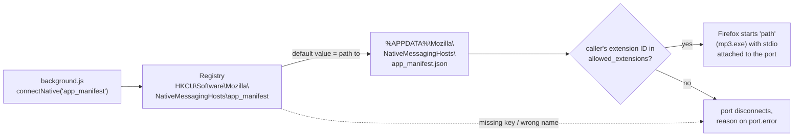

Host manifest, written by the installer:

```json
{
  "name": "app_manifest",
  "description": "YouTube MP3 Converter and Downloader",
  "path": "C:\\Users\\...\\AppData\\Local\\YouTube MP3 Downloader\\mp3.exe",
  "type": "stdio",
  "allowed_extensions": ["yt.downloader@converter.org"]
}
```

Any lookup failure (missing key, wrong name or path, ID not allowed) disconnects the port
immediately with the reason on `port.error`. `background.js` converts this into an error
response; it is what the user sees when the host is not installed.

**Identifiers that must match everywhere.** Changing any of them breaks existing installs
and AMO updates.

| Identifier       | Value                         | Defined in                                                                                                                                         |
|------------------|-------------------------------|----------------------------------------------------------------------------------------------------------------------------------------------------|
| Native host name | `app_manifest`                | `background.js` (`NATIVE_HOST_NAME`), `mp3_installer.iss` (`NativeHostName`), `app_manifest.dev.json` (`name`), registry subkey, manifest filename |
| Extension ID     | `yt.downloader@converter.org` | `extension/manifest.json` (`gecko.id`), `mp3_installer.iss` (`ExtensionID`), `app_manifest.dev.json` (`allowed_extensions`)                        |
| Executable name  | `mp3.exe`                     | PyInstaller `--name mp3`, `mp3_installer.iss` (`NativeExeName`)                                                                                    |

### 3.2 Wire format

Both directions:

```
[ 4 bytes: length N, unsigned int, native byte order ][ N bytes: UTF-8 JSON ]
```

Implemented in `native_messaging.py`:

- `read_message()`: reads exactly 4 bytes of length (`struct` `@I`), then exactly N bytes,
  then `json.loads`. On EOF (stdin closed, also mid-message) it calls `sys.exit(0)`; this
  is the normal shutdown path. A message that is not a JSON object raises `ValueError`,
  which `main()` reports as a final error.
- `send_message(dict)`: writes length + JSON to `sys.stdout.buffer` and flushes. On write
  failure (pipe closed) it logs and exits.

stdout is the protocol channel. Any other output to stdout corrupts the stream: no
`print()` in host code. Use `logging` (`mp3.log`, ERROR level).

### 3.3 Process lifetime

`connectNative()` spawns a new process per call, and the extension opens one port per
request, so every request runs in a fresh `mp3.exe`.

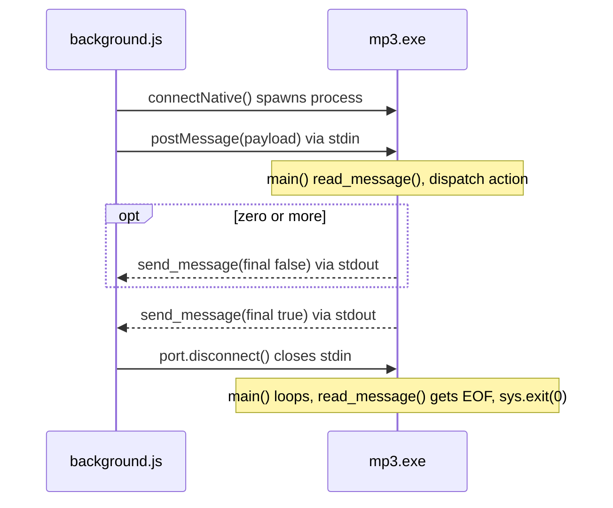

Exception: `download_gui`. Firefox kills the host when its port disconnects, and the Tk
window must outlive the request, so `background.js` leaves that port open
(`KEEP_ALIVE_ACTIONS`). The host sends its final `"GUI opened"` response, runs
`mainloop()` until the window is closed, and then exits by itself (`sys.exit(0)` in
`MP3.download_gui`), since nothing will close its stdin.

---

## 4. Message protocol

### 4.1 Requests (extension → host)

```json
{ "action": "download", "url": "https://...", "folder": "C:\\...", "filename": "..." }
```

| `action`             | Fields                         | Host behaviour                                                                                      | Timeout (`background.js`)   |
|----------------------|--------------------------------|-----------------------------------------------------------------------------------------------------|-----------------------------|
| `download`           | `url`, `folder?`, `filename?`  | Headless download, `run_native()`                                                                   | 6 min                       |
| `download_gui`       | `url?`, `folder?`, `filename?` | Opens the pre-filled Tk window, `gui.open_gui()`                                                    | 30 s (until `"GUI opened"`) |
| `select_folder`      | `folder?`                      | Folder picker starting at `folder`; returns the selection, or `folder` (else the default) on cancel | 10 min (user interaction)   |
| `get_current_folder` | —                              | Returns the default folder, creating it if missing                                                  | 15 s                        |

The host treats a missing or unknown `action` as `download`. `background.js` rejects
unknown actions before spawning the host, so this path is not reached from the extension.

### 4.2 Responses (host → extension)

```json
{ "status": "success" | "error" | "warning",
  "message": "...", "filename": "...", "path": "...", "folder": "...",
  "final": true | false }
```

| Field              | Meaning                                                                                                                                                                                                                                                                                                   |
|--------------------|-----------------------------------------------------------------------------------------------------------------------------------------------------------------------------------------------------------------------------------------------------------------------------------------------------------|
| `final: false`     | Intermediate message; request still running. Only `download` sends them: "Invalid folder path, using default", "Could not fetch the video title, …", "No thumbnail found, …". The final success repeats the download warnings in `message`, since the sidebar replaces the warning with the final result. |
| `final: true`      | Last message for the request. Exactly one per request.                                                                                                                                                                                                                                                    |
| `filename`, `path` | Set on a successful download.                                                                                                                                                                                                                                                                             |
| `folder`           | Set by folder actions.                                                                                                                                                                                                                                                                                    |

If `final` is absent, `background.js` treats `success`/`error` as final and anything else
as intermediate.

### 4.3 Extension envelope

`background.js` relays every response to extension pages as:

```json
{ "type": "native_response", "requestId": "<uuid>", "final": true, "...": "host fields" }
```

`requestId` correlates a response with the sidebar call that issued it.

---

## 5. Extension

All files are plain scripts sharing one global scope per page. `youtube.js` is loaded
before the page script in both the background page and the sidebar, which makes
`isYouTubeUrl` a global in both.

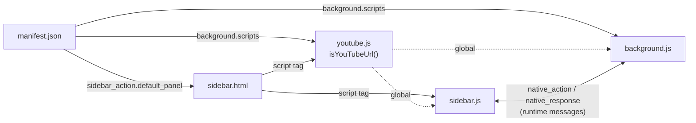

### 5.1 `background.js`

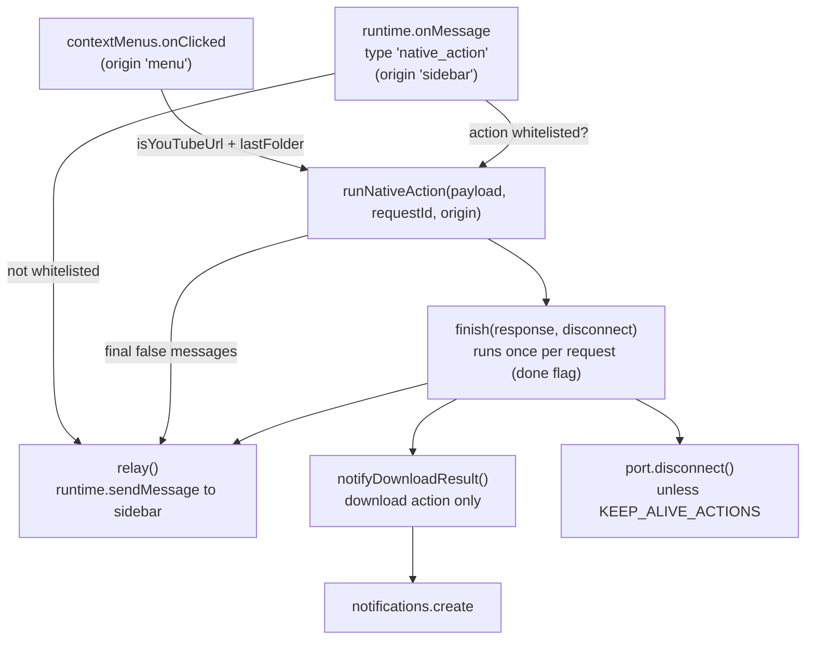

| Function / listener                           | Responsibility                                                                                                                                                   |
|-----------------------------------------------|------------------------------------------------------------------------------------------------------------------------------------------------------------------|
| `contextMenus.create` (top level)             | Registers "Download as MP3" for YouTube watch/shorts/youtu.be links. Runs on every startup because MV2 persistent backgrounds do not keep menus across restarts. |
| `runtime.onMessage`                           | Accepts `native_action` from the sidebar. Rejects actions not in `ACTION_TIMEOUTS_MS`. Copies only `action`, `url`, `folder`, `filename` into the payload.       |
| `contextMenus.onClicked`                      | Validates the link, adds `storage.local.lastFolder` if set, starts a `download`.                                                                                 |
| `runNativeAction(payload, requestId, origin)` | Opens the port, posts the payload, starts the timeout. Guarantees exactly one final response via `finish()`.                                                     |
| `relay(message)`                              | Sends `native_response` to extension pages. Rejection (no page open) is ignored.                                                                                 |
| `notifyDownloadResult(origin, response)`      | `download` only. Context-menu downloads always notify; sidebar downloads notify only if the sidebar is closed when the result arrives.                           |

`runNativeAction` completion: the first trigger wins, later ones are ignored.

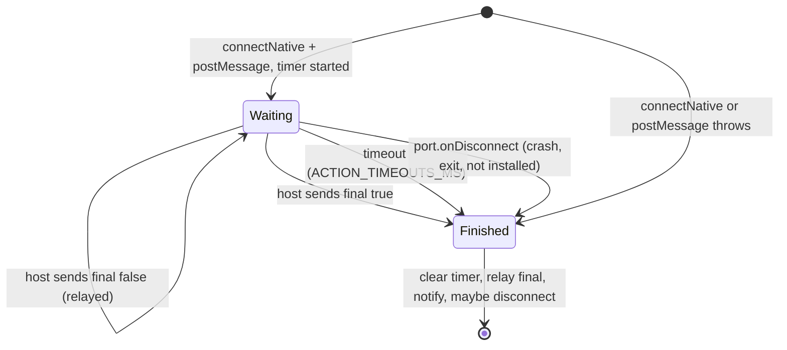

### 5.2 `sidebar.js`

| Area                             | Behaviour                                                                                                                                                                                                                   |
|----------------------------------|-----------------------------------------------------------------------------------------------------------------------------------------------------------------------------------------------------------------------------|
| Request tracking                 | `sendNativeAction(message, onResponse)` generates a `requestId` and stores the callback in `pendingRequests`. The `runtime.onMessage` listener dispatches each response by `requestId` and removes the entry on `final`.    |
| URL field                        | `syncUrlFromActiveTab()` mirrors the active tab's URL when it is a YouTube video, on tab switch and in-page navigation. Skipped once the user types a URL (`autofilledUrl` tracks the last autofilled value).               |
| Folder field                     | `loadFolder()` uses `storage.local.lastFolder`; if unset, requests `get_current_folder` and stores the result. Manual edits are saved on `change`; an empty value removes the key. Context-menu downloads use the same key. |
| Download button                  | Validates with `isYouTubeUrl`, sends `download`. Intermediate responses show as info/warning, the final one as success/error.                                                                                               |
| Open in app button               | Sends `download_gui` with whichever fields are filled.                                                                                                                                                                      |
| Choose button                    | Sends `select_folder` with the current folder field, so cancelling keeps it.                                                                                                                                                |
| `showResult()` / `clearResult()` | Status pill; success messages auto-hide after 5 s.                                                                                                                                                                          |

### 5.3 `youtube.js`

`isYouTubeUrl(value)` accepts http(s) URLs on `youtube.com`, `www.`, `m.`, `music.` or
`youtu.be`, with path `/watch?v=…`, `/shorts/…`, or a non-empty `youtu.be/<id>`.

The host validates much more loosely (`core.is_youtube_url`: substring `youtube.com` /
`youtu.be/`, used by both `run_native` and the GUI). The extension check is the effective
validation.

---

## 6. Native host

### 6.1 Module dependencies

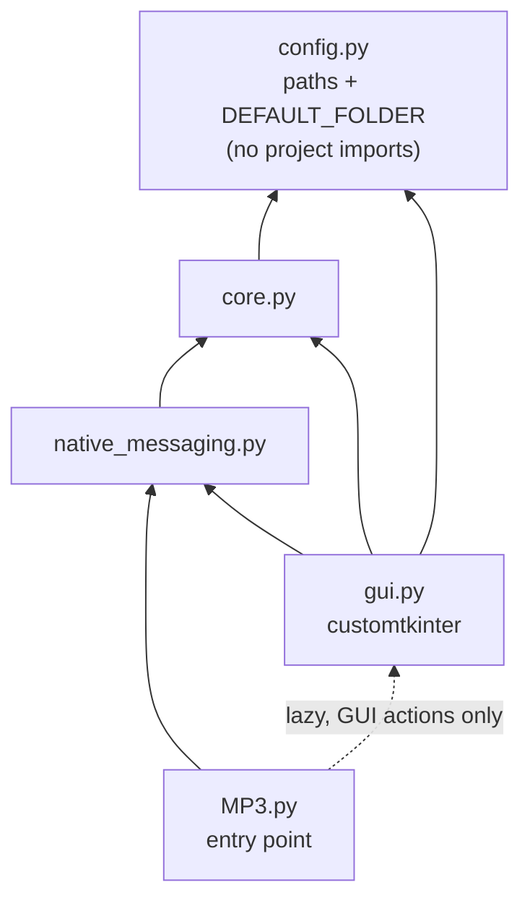

Arrows point from importer to imported. `MP3.py` is the only entry point; `__init__.py`
is empty. `MP3.py` imports `gui` inside the `download_gui` / `select_folder` handlers, so
headless requests never load customtkinter or create a Tk window. `MP3.py` is also the
only module that configures logging.

### 6.2 `config.py`

| Mode            | Detection                  | `ffmpeg.exe`, `yt-dlp.exe`    | `mp3.ico`                     |
|-----------------|----------------------------|-------------------------------|-------------------------------|
| Installed       | `sys.frozen` (PyInstaller) | Directory of `sys.executable` | Directory of `sys.executable` |
| Source checkout | otherwise                  | `host/bin/` (placed manually) | `packaging/assets/`           |

`DEFAULT_FOLDER = ~/Documents/YT-MP3-Downloads`.

### 6.3 `MP3.py`

`ACTIONS` maps each action name to a handler taking the request dict. Nothing GUI-related
is imported at module level.

| Handler              | Behaviour                                                                                                             |
|----------------------|-----------------------------------------------------------------------------------------------------------------------|
| `download`           | `native_messaging.run_native(url, folder, filename)`                                                                  |
| `download_gui`       | `gui.open_gui(...)`, then `sys.exit(0)` once the window is closed (the port is kept open, so stdin never reaches EOF) |
| `select_folder`      | `gui.select_folder(folder)`                                                                                           |
| `get_current_folder` | `send_current_folder("")`: the default folder, created if missing                                                     |

**`main()` request loop.**

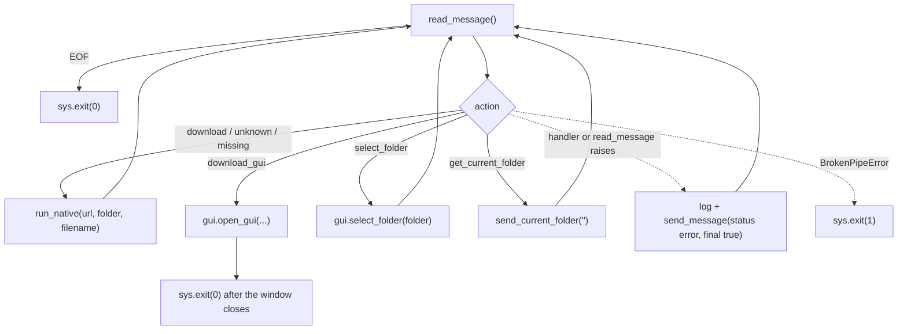

`send_message` exits the process itself if stdout is gone, so an error response can
never loop.

### 6.4 `gui.py`

`DownloaderApp(ctk.CTk)` is the window. Tk is not thread-safe: Tk variables are read on
the main thread only, and the worker thread changes widgets only via `self.after(0, …)`.

| Function                                       | Behaviour                                                                                                                                                                                                                       |
|------------------------------------------------|---------------------------------------------------------------------------------------------------------------------------------------------------------------------------------------------------------------------------------|
| `open_gui(url, folder, filename)`              | Builds the window and calls `run_native_gui`.                                                                                                                                                                                   |
| `run_native_gui(url, folder, filename)`        | Pre-fills the fields. Invalid folder → the default folder is kept, the window's status label and the final `"GUI opened, folder not found …"` message say so. Schedules the final response (100 ms) and blocks in `mainloop()`. |
| `start_download()`                             | Main thread: validates URL (`is_youtube_url`) and folder (`resolve_folder`), switches the button to Cancel (so a second click cannot start a second download), then starts `_download_thread` with the values.                  |
| `_download_thread(url, folder_path, filename)` | Calls `core.download_audio` with `on_progress` (progress bar) and `on_start` (remembers the process for cancel; kills it if Cancel was clicked before yt-dlp started). Shows the result.                                        |
| `cancel_download()`                            | Sets `download_cancelled`, kills the yt-dlp tree, resets the UI, starts `cleanup_partial_downloads()` on a thread.                                                                                                              |
| `cleanup_partial_downloads(temp_stem)`         | Waits 2 s, then `core.remove_temp_files` (fallback; `download_audio` already cleans up on exit).                                                                                                                                |
| `reset_fields()`                               | Clears URL and filename and restores the "Download MP3" button.                                                                                                                                                                 |
| `select_folder(folder)`                        | Hidden topmost root + `askdirectory` starting at `folder` (else the default). Sends the selection, or the start folder on cancel.                                                                                               |

Main button states:

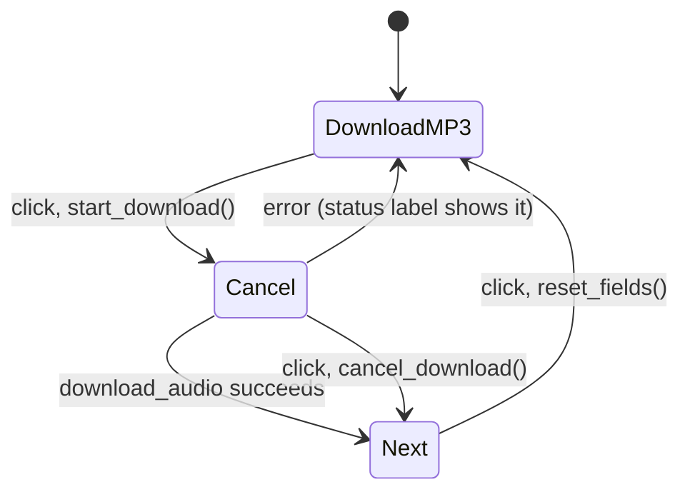

### 6.5 `native_messaging.py`

`read_message()` / `send_message()`: see §3.2. `send_current_folder(folder)` answers the
folder actions via `core.resolve_folder`.

`run_native(url, folder, filename)` handles a headless `download`:

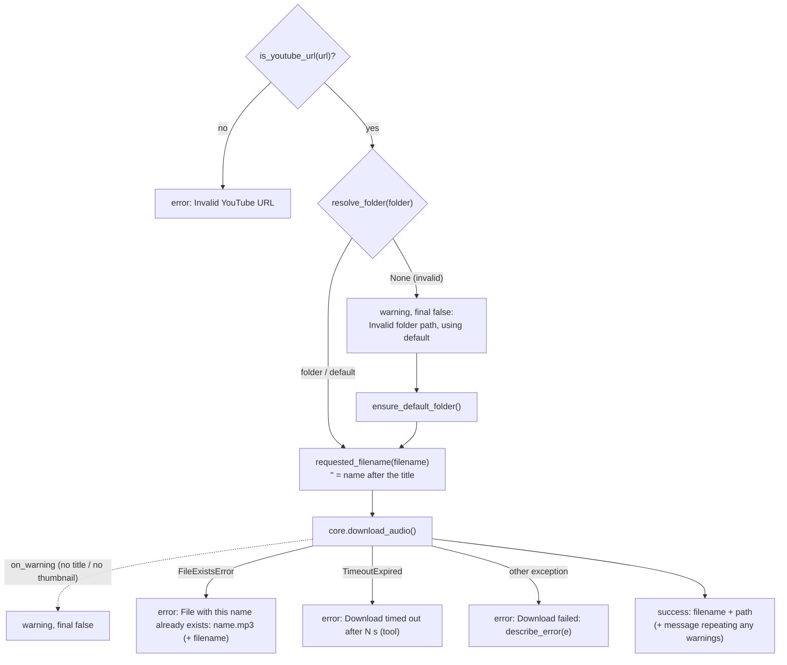

Error texts come from `core.describe_error`, shared with the GUI: yt-dlp failures show
yt-dlp's own last `ERROR:` line (e.g. "This video is unavailable"), never the command line.

### 6.6 `core.py`

| Function                                                                            | Behaviour                                                                                                                                                                                                                                                                                        |
|-------------------------------------------------------------------------------------|--------------------------------------------------------------------------------------------------------------------------------------------------------------------------------------------------------------------------------------------------------------------------------------------------|
| `is_youtube_url(url)`                                                               | Substring check for `youtube.com` / `youtu.be/`.                                                                                                                                                                                                                                                 |
| `safe_filename(name)`                                                               | Strips `\/*?:"<>\|`; removes whole-word noise (`NOISE_WORDS`: `Official`, `Music`, `Video`, `HD`, `Lyrics`, …); removes resulting empty `()`/`[]`; collapses whitespace. Empty → `DEFAULT_FILENAME` (`"Youtube MP3"`).                                                                           |
| `requested_filename(name)`                                                          | `safe_filename`, but returns `""` when nothing meaningful is left, meaning "name it after the title".                                                                                                                                                                                            |
| `ensure_default_folder()`                                                           | Creates `DEFAULT_FOLDER` if missing; returns it.                                                                                                                                                                                                                                                 |
| `resolve_folder(folder)`                                                            | Empty or the default folder → `ensure_default_folder()`; an existing directory → itself; otherwise `None`.                                                                                                                                                                                       |
| `artist_from_filename(filename)`                                                    | Text before the first `-`, else `<unknown>`.                                                                                                                                                                                                                                                     |
| `download_audio(url, folder, filename, on_progress, on_start, on_warning, timeout)` | The single pipeline (§6.7). `on_warning` reports a missing title or thumbnail. Verifies the final MP3 exists before returning it. Raises `FileExistsError`, `FileNotFoundError` (ffmpeg/yt-dlp missing, no MP3 produced), `TimeoutExpired`, `CalledProcessError`. Temp files are always removed. |
| `describe_error(error)`                                                             | One-line user message for a `download_audio` exception (headless and GUI).                                                                                                                                                                                                                       |
| `embed_thumbnail(temp_mp3, thumb, artist, output)`                                  | One ffmpeg pass (50 s timeout): audio copied, thumbnail center-cropped 1:1 as JPEG `-q:v 2`, ID3v2.3, artist. Writes `output` directly (`-n`), removes it on failure.                                                                                                                            |
| `kill_process_tree(process)`                                                        | `taskkill /F /T`; yt-dlp.exe is a onefile build, `Popen.kill()` only stops its bootloader.                                                                                                                                                                                                       |
| `remove_temp_files(temp_stem)`                                                      | Deletes `<temp_stem>.*`, retrying files Windows still locks after a kill.                                                                                                                                                                                                                        |

### 6.7 Download pipeline

```
yt-dlp.exe --no-playlist --concurrent-fragments 3
           -x --audio-format mp3 --audio-quality 0
           --write-thumbnail
           --ffmpeg-location <ffmpeg.exe>
           --print after_move:YTMP3_TITLE:%(title)s
           --progress --newline --encoding utf-8
           -o "<folder>/_ytmp3_<hex>.%(ext)s"
           <url>
```

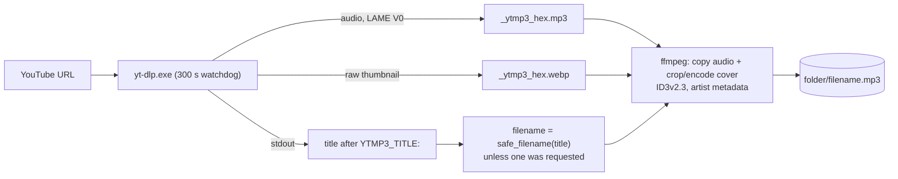

- Output goes to a unique temp stem, so the title is only needed after the download; there
  is no separate `--get-title` call. With a requested filename the "already exists" check
  runs before the download, otherwise after it.
- The watchdog kills the whole tree after `DOWNLOAD_TIMEOUT_S`; a callback that raises
  also kills it.
- `--newline` emits one progress line per update; `on_progress` gets `NN.N% / 100`.

---

## 7. Request flows

### 7.1 Sidebar download (headless)

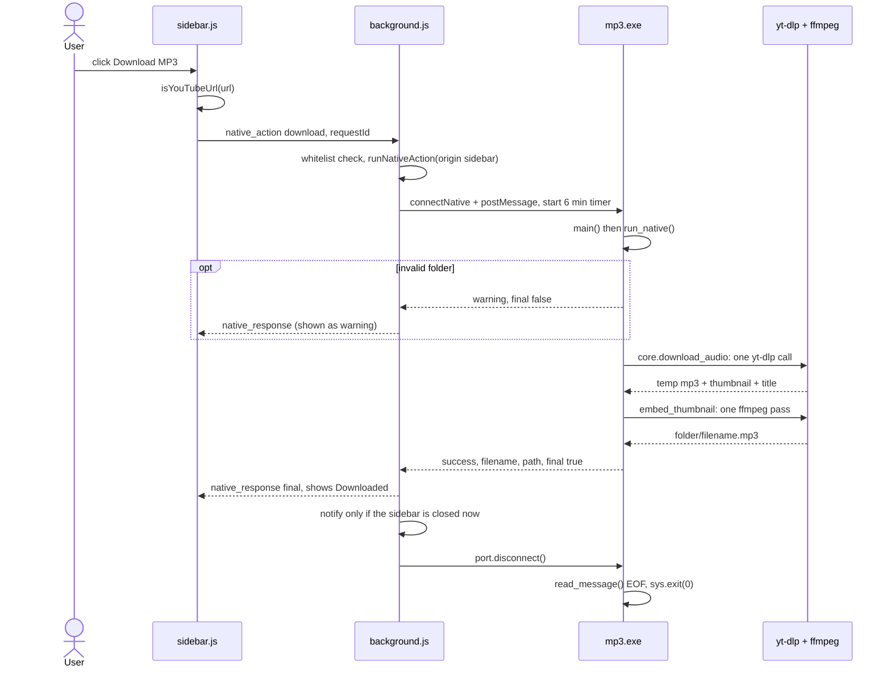

### 7.2 Open in app (GUI)

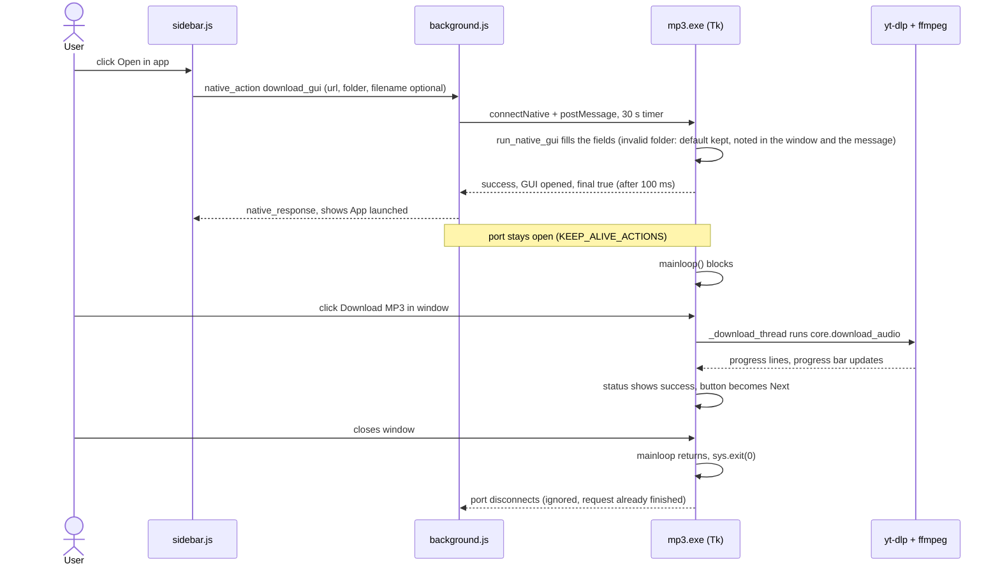

After `"GUI opened"`, the GUI reports nothing back to the extension.

### 7.3 Context-menu download

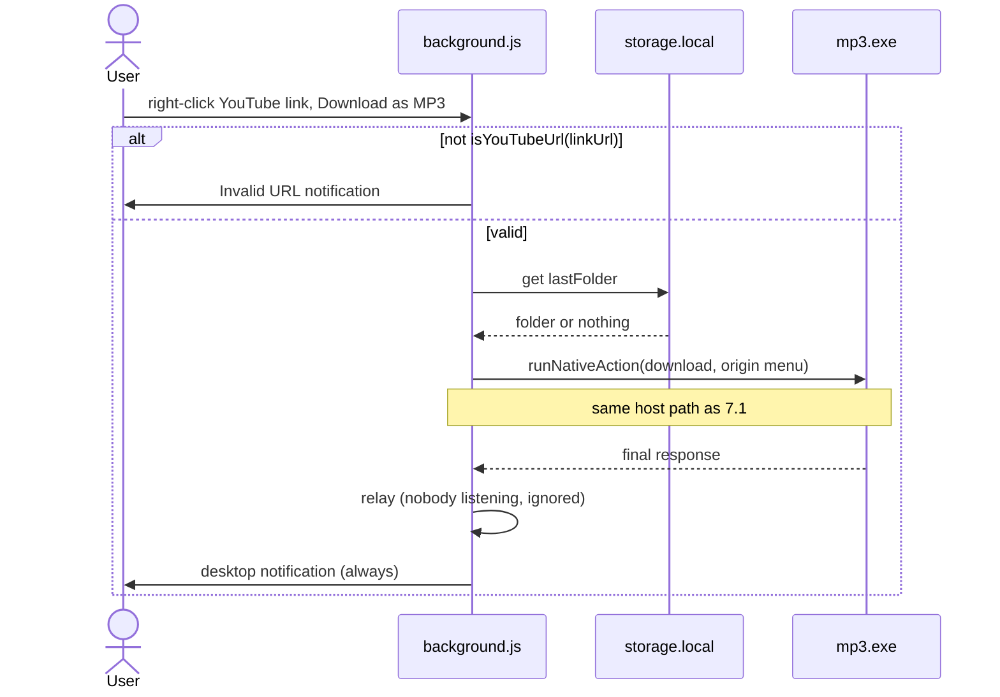

### 7.4 Folder actions

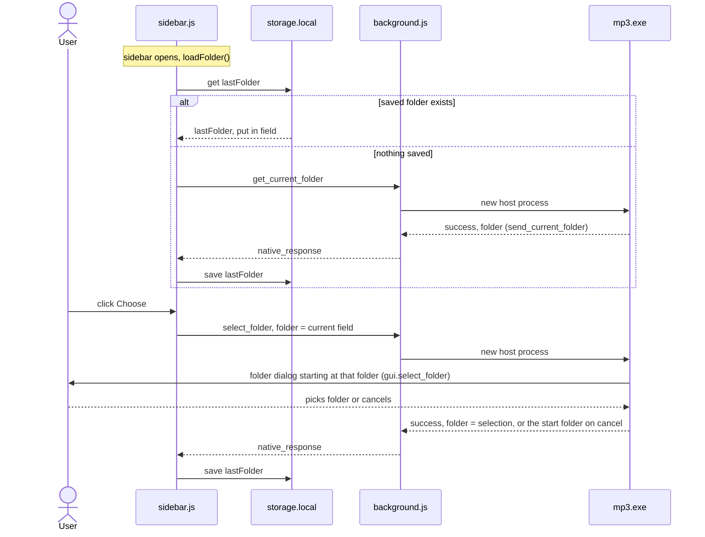

Cancelling the dialog keeps the previously selected folder. `get_current_folder` creates
the default folder if it does not exist yet.

---

## 8. Build and release

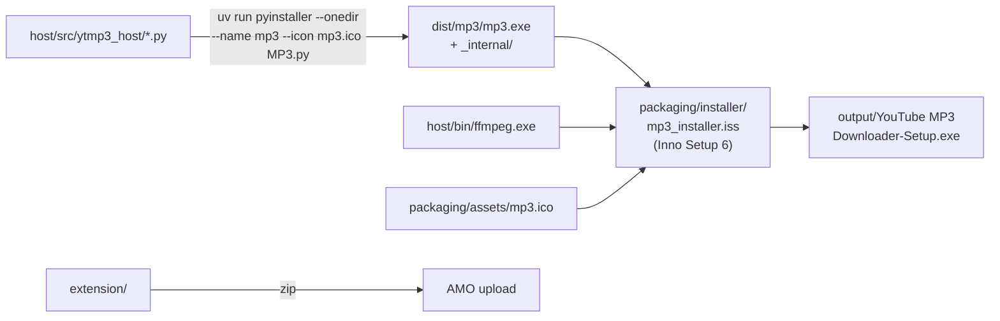

Installer steps (per-user, no elevation):


- yt-dlp is downloaded at install time, not bundled: YouTube changes regularly break older
  yt-dlp versions. A failed download aborts the install.
- All binaries and the icon land in one folder, matching `config.py`'s frozen-mode paths.
- Uninstall removes the registry key, the host manifest, `yt-dlp.exe` and `mp3.log`
  (listed under `[UninstallDelete]` because they are created at runtime, not via `[Files]`).
- The extension is versioned and released separately (`manifest.json` `version` vs.
  `MyAppVersion` in the `.iss`).

---

## 9. Development workflow

| Task                              | How                                                                                                                                                                                                                                                                                                  |
|-----------------------------------|------------------------------------------------------------------------------------------------------------------------------------------------------------------------------------------------------------------------------------------------------------------------------------------------------|
| Python environment                | `uv sync`; place `ffmpeg.exe` and `yt-dlp.exe` in `host/bin/`.                                                                                                                                                                                                                                       |
| Register a dev host               | Copy `packaging/app_manifest.dev.json` to `%APPDATA%\Mozilla\NativeMessagingHosts\app_manifest.json`, set `path` to your `dist\mp3\mp3.exe` (copy `ffmpeg.exe`, `yt-dlp.exe`, `mp3.ico` next to it), remove the `"\\"` comment key, and create the `HKCU` key from §3.1 (or run the installer once). |
| Test host changes through Firefox | Rebuild `mp3.exe` with PyInstaller; the manifest points at an executable.                                                                                                                                                                                                                            |
| Test the host without Firefox     | `uv run python host/tests/smoke_native.py`. Sends one hard-coded message to `dist/mp3/mp3.exe` (fallback: `python -m ytmp3_host.MP3`) and prints the reply. Edit `message` to change the action. Not pytest-safe: calls yt-dlp at import.                                                            |
| Load the extension                | `about:debugging` → Load Temporary Add-on → `extension/manifest.json`.                                                                                                                                                                                                                               |
| Extension tests                   | `node --test tests/extension/`                                                                                                                                                                                                                                                                       |

Extension test harness:

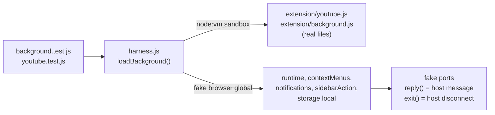

`background.test.js` covers the request lifecycle: single final response, keep-alive,
timeouts, disconnect errors, notifications, context menu. `youtube.test.js` covers
`isYouTubeUrl`. `sidebar.js` and the Python host have no automated tests.

---

## 10. Invariants and change checklist

**Invariants**

- No stdout output in host code other than `send_message`.
- Exactly one `final: true` response per request. Intermediate responses must set
  `final: false` explicitly.
- `ACTION_TIMEOUTS_MS.download` (6 min) must exceed the yt-dlp timeout
  (`DOWNLOAD_TIMEOUT_S`, 300 s) + the ffmpeg timeout (`EMBED_TIMEOUT_S`, 50 s); otherwise
  the extension times out while the host is still working.
- `app_manifest`, `yt.downloader@converter.org` and `mp3.exe` are fixed (§3.1).
- Download logic lives in `core.py` only; both the headless and the GUI path call
  `core.download_audio`.
- Nothing the headless path imports may import customtkinter at module level; `gui.py`
  is imported only inside the GUI handlers.
- Tk is touched only from the main thread (`gui.py` worker threads use `after(0, …)`).
- Child processes get `stdin=DEVNULL`; yt-dlp is stopped with `kill_process_tree`.
- A `KEEP_ALIVE_ACTIONS` handler must exit the host itself when it is done.

**Adding a host action**

1. `ACTION_TIMEOUTS_MS` in `background.js` (whitelist + timeout).
2. `ACTIONS` dict in `MP3.py`.
3. Caller in `sidebar.js`.
4. `KEEP_ALIVE_ACTIONS` if the host must outlive its final response (then exit the host
   from the handler when done, like `download_gui`).
5. A test in `tests/extension/background.test.js` if lifecycle behavior changes.

**Changing yt-dlp arguments:** `core.build_download_command`. Measure download time
before and after (see the project priorities in `CLAUDE.md`).

**Logging:** `mp3.log` in the process working directory (the installer assumes the
install folder), ERROR level.

---

## 11. Known issues

None currently tracked. Resolved:

| Former issue                                                                                                                     | Resolution                                                                                                                                                                  |
|----------------------------------------------------------------------------------------------------------------------------------|-----------------------------------------------------------------------------------------------------------------------------------------------------------------------------|
| `get_current_folder` did not create the default folder                                                                           | `send_current_folder` uses `core.resolve_folder`, which creates the default folder when it is requested.                                                                    |
| Host lingered after `download_gui` (rejected folder, and also after the window was closed)                                       | An invalid folder opens the window with the default folder and says so (window + final message); `MP3.download_gui` exits the host when the window closes or fails to open. |
| Dead auto-close code (`close_var`)                                                                                               | Removed.                                                                                                                                                                    |
| Headless download only logged "file exists" / "ffmpeg missing"                                                                   | `core.download_audio` raises `FileExistsError` / `FileNotFoundError`, which `run_native` reports with a specific message.                                                   |
| `select_folder` cancel returned the default folder                                                                               | The sidebar sends its current folder; the picker starts there and returns it on cancel.                                                                                     |
| GUI read Tk variables from the download thread; double click could start two downloads; Cancel before yt-dlp started was ignored | Fixed in `gui.py` (§6.4).                                                                                                                                                   |
| `.part` files could survive a killed download (Windows locks)                                                                    | `core.remove_temp_files` retries locked files.                                                                                                                              |
| "Could not fetch title" warning lost in the file split; missing thumbnail only logged                                            | `download_audio(on_warning=…)`, shown in the sidebar and the GUI.                                                                                                           |
| Error messages contained the raw yt-dlp command line                                                                             | `core.describe_error`.                                                                                                                                                      |
| GUI said "canceled" when Cancel came after the file was already saved                                                            | The GUI reports the saved file.                                                                                                                                             |
